# Control, Sensing & Jump Coordination — P1 report

Owner: Robotics & Control Engineer · Date: 2026-11-04 · Phase P1 (design/research only, no CAD) · Status: draft for Gate B

## 1. Summary

- **Split:** drivers (MKS XDrive Mini, ODrive 3.6 fw) run current at 8 kHz in **torque mode**. The ESP32 runs the estimator at 1 kHz and the balance/leg/jump controller at **500 Hz**. The Pi 4 runs SLAM, path planning and teleop at 10–50 Hz and sends only setpoints (v, yaw rate, leg height, roll offset, mode).
- **Bus:** one CAN bus at 1 Mbit/s for the ESP32 and the 4 drivers. **At 1 kHz the 4 drivers will not fit on one bus** (bus load over 100 %, §3.2). 500 Hz uses about 55 % of the bus. Pi to ESP32 is a UART at 921 600 baud.
- **IMU:** **TDK ICM-42688-P** on SPI, with gyro and accel at 1 kHz output rate and the internal anti-alias filter on. Mount it rigidly on the ESP32 PCB, on the body mid-plane, within 30 mm of the body CoM. Fallback if landings saturate ±16 g: BMI088 (±24 g).
- **Encoders:** the AS5047P sits on the motor side. Through a 9:1 hip gearbox the motor's single-turn absolute angle repeats every 40° of output, so **the hip needs homing** (against the crouch hard stop) or a cheap output-side magnetic encoder (recommended). Wheels need no absolute position.
- **Controller:** LQR on a wheeled inverted pendulum, with gains scheduled by leg length (tabulated at 5 or more heights and interpolated). Roll comes from differential leg length (PD plus feed-forward), yaw from differential wheel torque (PI on yaw rate). Leg length uses impedance control on the hips.
- **Sim result** (`calc/sim_lqr_2d.py`, numpy only because scipy is not installed). The physics minimum total wheel torque to recover is about **0.3 N·m from 5° and 0.6–0.8 N·m from 10°**. Unclipped LQR asks for 6 N·m (5°) and 12 N·m (10°) but still recovers when clipped to below 1 N·m. Traction caps useful total wheel torque at about **2.5 N·m (μ = 0.8)**. **Balance needs little torque. The wheel ratio is set by speed headroom, not torque** (§3.4). With KV 90 on 6S this points to N ≈ 3–4, not 5–6.
- **Jump:** the sequence is crouch, thrust (~115 ms), flight (~0.4 s), pre-position, impedance landing, then re-balance. The hip *speed* at take-off probably exceeds what an 8308 with 9:1 can deliver at 6S. This is flagged as the main risk to the 20 cm jump.

## 2. Assumptions

| # | Assumption | Value | Owner to confirm |
|---|---|---|---|
| A1 | Total mass | 3.8 kg (budget target; hard limit 4.0) | BOM |
| A2 | One wheel assembly (hub motor + planetary + wheel + tyre), unsprung | 0.50 kg | Theory/BOM |
| A3 | Wheel radius | 0.085 m (Ø170) | Theory |
| A4 | Body CoM height above axle, *l* | 0.15 (crouch) / 0.25 (nominal) / 0.35 m (extended) | Mech (P2 layout) |
| A5 | Body pitch radius of gyration | 0.12 m | Mech |
| A6 | Wheel + tyre + ring spin inertia, one wheel | 1.0e-3 kg·m² | Mech |
| A7 | 8308 rotor inertia | 2.0e-4 kg·m² (estimate: ~0.1 kg ring at r ≈ 44 mm). **Unverified** | Theory |
| A8 | 8308 KV | 90 rpm/V (client says NOT confirmed). Kt ≈ 8.27/KV ≈ 0.092 N·m/A | Theory |
| A9 | Bus voltage for speed calcs | 21 V (6S under load/sag); 25.2 V max | Electrical |
| A10 | Driver firmware | ODrive 0.5.x-compatible (MKS fork). CAN "simple" protocol, torque mode, axis watchdog. No field weakening assumed | Electrical |
| A11 | Tyre-ground friction | μ = 0.8 (TPU on concrete/wood) | Materials |
| A12 | Legs are lumped into the body for the 2D model (light legs) | — | — |

## 3. Calculations

### 3.1 Control architecture

```mermaid
flowchart LR
  subgraph PI["Raspberry Pi 4 — high level (Linux, not real-time)"]
    L[LD19 lidar 10 Hz] --> SLAM[SLAM / mapping<br/>slam_toolbox or Cartographer]
    CAM[Pi camera] --> VIS[vision / teleop video]
    SLAM --> NAV[path planner / teleop<br/>10–50 Hz]
    SLAM --> WIFI[Wi-Fi map upload]
  end
  subgraph ESP["ESP32 custom PCB — real time (FreeRTOS, core 1 pinned)"]
    IMU[ICM-42688-P SPI 1 kHz] --> EST[estimator 1 kHz<br/>pitch/roll KF + odometry + leg kin.]
    EST --> BAL[balance LQR (gain-scheduled) 500 Hz]
    EST --> LEG[leg impedance + roll 500 Hz]
    EST --> YAW[yaw-rate PI 500 Hz]
    FSM[mode FSM: idle/stand/drive/jump/fall] --> BAL & LEG & YAW
    SAFE[safety monitor 500 Hz<br/>fall / lift / watchdog / limits] --> FSM
    BAL & YAW --> MIX[wheel torque mix L/R]
  end
  NAV -- "UART 921600, 50 Hz:<br/>v, yaw rate, leg height, roll, mode" --> FSM
  EST -- "telemetry 100 Hz: pose, odom, state" --> NAV
  MIX -- "CAN 1 Mbit: Set_Input_Torque" --> DWL[XDrive wheel L] & DWR[XDrive wheel R]
  LEG -- "CAN: Set_Input_Torque" --> DHL[XDrive hip L] & DHR[XDrive hip R]
  DWL & DWR & DHL & DHR -- "Encoder_Estimates 500 Hz, Iq/Vbus 50 Hz, heartbeat" --> EST
  ESTOP[hardware e-stop / RC kill] -.-> DWL & DWR & DHL & DHR
  ESTOP -.-> SAFE
```

| Layer | Runs | Rate | Notes |
|---|---|---|---|
| Driver current loop (FOC) | XDrive | 8 kHz (ODrive fixed) | Current bandwidth default 1000 rad/s (~160 Hz). That is more than 10× the balance crossover, so it is good enough. |
| Driver velocity/position loop | XDrive | 8 kHz | **Not used in balance** (torque mode). Used only for 6a bench tests and hip homing. |
| IMU sampling + estimator | ESP32 | 1 kHz | SPI read uses no bus time. |
| Balance LQR, leg impedance, roll, yaw, safety | ESP32 | **500 Hz** | Open-loop unstable pole is 6–7 rad/s (~1.1 Hz, from the sim), so 500 Hz is about 450× faster. |
| Mode FSM / jump sequencer | ESP32 | 500 Hz | Jump timing resolution 2 ms. |
| Commands from Pi | Pi to ESP32 | 50 Hz | ESP32 holds the last command; timeout behaviour in §7. |
| SLAM / planning | Pi | 10 Hz lidar, 10–50 Hz planner | Wheel odometry + IMU yaw fused on the Pi (robot_localization EKF). |

### 3.2 CAN bus budget (1 Mbit/s, 11-bit IDs, 8-byte payloads)

- One frame is about 111 bits, or about 130 bits worst case with bit stuffing. That is **≈130 µs** per frame.
- Per control cycle: 4 × Set_Input_Torque out + 4 × Encoder_Estimates in = 8 frames = **1.04 ms**.
- **1 kHz cycle (1.0 ms period):** 8 frames plus Iq, heartbeats and errors comes to over 100 % bus load. **Not feasible on one bus.**
- **500 Hz (2.0 ms period):** 1.04 ms + ~0.1 ms of slow traffic ≈ **55 % load.** Recommended.
- To go to 1 kHz later there are 3 options. (a) Use an ESP32 variant with 2 TWAI controllers (e.g. ESP32-C6) or an MCP2518FD second bus, with one bus per side. (b) Use UART per driver (but the ESP32 has only 3 UARTs). (c) Use CAN-FD (but the XDrive does not support it).
- **Latency budget, 500 Hz:** IMU read 0.1 ms, estimator + LQR 0.1 ms, 4 Tx frames 0.55 ms, driver picks up the command at its next 125 µs cycle, current rise ~1 ms (τ = 1/1000 rad/s). Add a ZOH half-period of 1 ms and the total is **≈ 3 ms**. Phase lag at a 5 Hz crossover is 360 × 5 × 0.003 = **5.4°**, which is acceptable (the sim includes a 1-sample delay).

### 3.3 Sensors and state estimation

**IMU choice: ICM-42688-P** (alternatives: BMI088, MPU6050).

| | ICM-42688-P | BMI088 | MPU6050 |
|---|---|---|---|
| Gyro noise | 2.8 mdps/√Hz | 14 mdps/√Hz | ~5 mdps/√Hz |
| Accel range | ±16 g | ±24 g | ±16 g |
| Bus | SPI 24 MHz | SPI / I2C | I2C |
| Anti-alias filter | programmable on-chip | fixed | DLPF only |
| Status | current, cheap breakouts | current, drone-grade vibration robustness | **obsolete (TDK)** / clones |

- **Pick ICM-42688-P:** lowest noise, on-chip AAF, SPI. Settings: ODR 1 kHz, AAF ≈ 250 Hz, gyro ±2000 dps, accel ±16 g. Use **BMI088** if 6e/6f logs show accel clipping at landing.
- **No magnetometer:** the motors and battery current make it useless. Yaw comes from gyro + wheel odometry and is corrected by SLAM on the Pi.

**IMU placement requirement for CAD:**
1. On the ESP32 PCB. The PCB is mounted **rigidly** to the body frame with 4 screws and no foam. The PCB first bending mode must be above 300 Hz (support spacing ≤ 60 mm).
2. Within **±30 mm of the body CoM** in X and Z, and on the L/R mid-plane within ±10 mm. This minimises the centripetal and tangential acceleration in the tilt estimate.
3. IMU axes aligned to body axes within ±2° (calibrated in software afterwards).
4. At least 40 mm from the driver boards and motors (heat drift, ~0.005 °/s/°C). Not on the battery tray, which moves for CoM trim.
5. Vibration isolation: use **none mechanically** (it adds phase lag and lets the IMU rotate relative to the body). Rely on the on-chip AAF plus a software notch if the 6a/6b logs show gear-mesh lines.

**Encoders (AS5047P, motor side, 14-bit = 16 384 counts/rev):**
- Output resolution: 360/16384/N = 0.0044° at the wheel (N = 5) and 0.0024° at the hip (N = 9). **Resolution is not the limit. Backlash is.**
- **Backlash** sits between the encoder and the joint, so the controller does not see it.
  - At the hip, 0.5° of output backlash × 0.2 m leg ≈ 1.7 mm of wheel position error and an unobserved roll error of ≈ 1.7/300 rad ≈ 0.3°. It also causes limit cycles in impedance control.
  - At the wheel, backlash is a dead zone inside the balance loop and produces a small pitch limit cycle, which is tolerable if it stays under 1°.
- **Absolute angle:** the AS5047P is absolute within one *motor* turn only. Through 9:1, output angle is known mod 40°. If the planetary ratio is non-integer (1 + Zr/Zs), the mapping is not even periodic per output turn. **The hip needs either:**
  - (a) **Homing at power-up**: drive to the full-crouch hard stop at ≤ 3 A for ≤ 2 s and record the offset. This is cheap and always needed for calibration anyway. **Or**
  - (b) **Recommended:** an output-side magnetic encoder (AS5600 or MT6701, about 2 €) on each hip joint shaft, read by the ESP32 over I2C or analog. It gives absolute leg angle at boot, measures backlash directly, and allows backlash compensation and fault detection (when the motor and joint encoders disagree beyond the backlash, flag a slipped or broken gear).
- Wheels: relative position only; the AS5047P is enough.

**Estimator (ESP32, 1 kHz):**
1. **Pitch/roll:** a 2-state Kalman filter (angle + gyro bias) per axis, or a Mahony complementary filter as the first version. The accel correction uses **acceleration compensation**: subtract the body acceleration predicted from wheel odometry (a = r·φ̈ from encoder velocity, filtered) before the accel correction. Lower the accel trust when ‖a‖ deviates from g by more than 0.15 g. **During flight, gyro integration only.**
2. **Velocity/position:** x and ẋ from the mean of the two wheel angles × r, **plus pitch-rate correction**. The ground-relative wheel angle is encoder angle (relative to the stator/leg) plus leg pitch, so θ̇ must be added back.
3. **Leg kinematics:** from the hip angle (output encoder or homed motor encoder), the 4-bar forward kinematics gives wheel position in the body frame: leg length L, leg angle, and the Jacobian J = ∂(wheel pos)/∂q_hip. These feed the LQR gain schedule (*l* = f(L)), the roll estimate and the leg force estimate F = J⁻ᵀ·τ_hip.
4. **Contact detection** (needed for the jump FSM): estimated leg force F above 30 % of the static load means stance. Wheel Iq near zero while wheel acceleration is high suggests no contact.

### 3.4 Balance controller

**Model:** 2D wheeled inverted pendulum, with states [x, ẋ, θ, θ̇] and input τ = total wheel output torque. It includes the gear-reflected rotor inertia J·N² and the fact that the stator is fixed to the leg (`sim_lqr_2d.py`). The leg length enters through *l*. LQR uses Bryson weights: x 0.5 m, ẋ 1 m/s, θ 0.1 rad, θ̇ 1 rad/s, τ 5 N·m.
- Nominal gain (l = 0.25, N = 5): K = [−10, −14.9, −66.6, −9.75].
- **Gain scheduling:** compute K offline at L = 5 or more leg lengths over the full range, store the table on the ESP32 and interpolate linearly on the estimated *l*. This is the same approach as Ascento (LQR plus leg-length scheduling) and LeTian.
- **Velocity command:** track the reference [x_ref = ∫v_cmd, v_cmd]. Do not offset θ directly; LQR finds the lean.

**Sim results** (nonlinear model, 500 Hz with 1-sample delay; torques are TOTAL for both wheels, at the wheel shaft):

| l [m] | N | tilt | hold torque (physics floor) | LQR unclipped peak | min clip that still recovers | peak wheel speed excursion |
|---|---|---|---|---|---|---|
| 0.15 | 5 | 5° | 0.21 | 5.6 | 0.23 | 0.16 m/s |
| 0.15 | 5 | 10° | 0.42 | 11.2 | 0.46 | 0.32 m/s |
| 0.25 | 5 | 5° | 0.26 | 5.9 | 0.29 | 0.23 m/s |
| 0.25 | 5 | 10° | 0.52 | 11.7 | 0.59 | 0.46 m/s |
| 0.35 | 5 | 5° | 0.29 | 6.1 | 0.34 | 0.30 m/s |
| 0.35 | 5 | 10° | 0.58 | 12.2 | 0.68 | 0.61 m/s |
| 0.35 | 4 / 6 | 10° | 0.53 / 0.64 | 12.1 / 12.4 | 0.60 / 0.77 | 0.63 / 0.58 m/s |

Unstable open-loop pole: 5.9–7.2 rad/s. The full table is in the script output.

**Interpretation:**
- The LQR peak (12 N·m) is only K₃·θ₀ at t = 0 with aggressive weights. It cannot be transmitted anyway: the **traction limit is μ·m·g·r = 2.5 N·m total** (1.27 N·m per wheel). The physics needs only about 0.6–0.8 N·m total to recover from 10° (slowly), and the controller saturates gracefully.
- A larger N **raises** the needed torque slightly, because the reflected rotor inertia J·N² grows. At N = 5 it is about 1.4 kg equivalent, roughly 35 % of the robot mass.
- **Conclusion: wheel torque is not the sizing constraint; speed headroom is.**

**Requirements for the wheel drive (to Theory):**
- **R-W1 (torque):** peak output torque per wheel ≥ **2.0 N·m** (1.5 × the traction limit at μ = 1.0, covering recovery, a 15° slope at 0.4 N·m per wheel, and bumps). Continuous ≥ **0.6 N·m** per wheel. An 8308 at 20 A (Kt 0.092) through 4:1 at η = 0.85 gives about 6 N·m, a large margin.
- **R-W2 (speed headroom):** wheel speed capability under load at V_min must reach **v_top + 1.0 m/s**. The 1.0 m/s covers 0.6 m/s for 10° recovery from the sim plus 0.4 m/s for push and bump rejection.
  - Rule: **N ≤ 0.85 · KV · V_min · (2π/60) · r / (v_top + 1.0)**.
  - Example, KV 90, V_min 21 V, r = 0.085: N ≤ **3.3** for 12 km/h and N ≤ **3.8** for 10 km/h.
  - **If KV 90 is confirmed, 5:1 and 6:1 cannot balance at top speed.** Either use 3.5–4:1, a higher-KV 8308 variant, or a larger wheel. A balancing robot that saturates speed at top speed falls forward. This is a hard requirement, not a nice-to-have.
- **R-W3 (backlash):** wheel gearbox backlash ≤ **1.0°** at the output (≤ 1.5 mm at the tyre).
- **R-W4 (stiffness/bandwidth):** target closed-loop crossover is 3–5 Hz. The torque path needs bandwidth ≥ 50 Hz, which the driver meets. The torsional resonance of wheel, gearbox and body must be **≥ 25 Hz** (5× crossover). Printed gear compliance must not bring it lower.
- **R-W5:** the gearbox must survive regen braking at full torque (back-driven at 2 N·m) and repeated torque reversals at 3–5 Hz (fatigue). This goes to Materials/Structural.

**Roll / single-leg climb:**
- The leg-length setpoints are L_L/R = L_cmd ± ΔL/2.
- Roll loop: ΔL = Kp·(φ_ref − φ) + Kd·(−φ̇) + feed-forward from terrain. The first guess is Kp ≈ 0.5 m/rad and Kd ≈ 0.05 m·s/rad. That is a 5° roll error giving 44 mm of differential, saturated at ±100 mm (R5).
- The roll reference is 0 (body level) on uneven ground. The *body* stays level while the legs absorb the step.
- The hips use **leg impedance** in leg-length space: F = k_L(L_ref − L) − c_L·L̇ + F_ff, where F_ff = m_b·g/2 + the roll feed-forward. Then τ_hip = Jᵀ·F.
  - Stance values: k_L ≈ 800 N/m and c_L ≈ 40 N·s/m per leg (ζ ≈ 0.8 with 1.45 kg per leg). Soft enough to absorb bumps.
- The mechanical springs carry part of F_ff. The controller subtracts the modelled spring force, so the spring curve must be supplied (Theory).

**Yaw:**
- τ_L,R = τ_bal/2 ∓ τ_yaw/2, with τ_yaw from a PI on yaw rate (gyro z): Kp ≈ 0.3 N·m/(rad/s).
- The yaw rate is limited when v is high and the legs are extended, to keep lateral acceleration ≤ 0.3 g (tip-over).

**Model parameters needed from Mechanics/Theory** (for the P5 sim and the final gains):
- Body mass and CoM (x, z) relative to the hip axis.
- Body inertia tensor about the CoM.
- Per-link mass, CoM and inertia for thigh, coupler and shank.
- 4-bar link lengths and pivot coordinates.
- Hip angle range and hard stops.
- Wheel radius (loaded).
- Spinning inertia of the wheel + tyre + ring and of the motor rotor.
- Wheel assembly mass (unsprung).
- Gear ratios (exact tooth counts) and efficiencies.
- Backlash, measured in 6a.
- Motor KV/Kt, phase resistance and inductance, pole pairs.
- Spring rate, preload and engagement angle vs hip angle.
- Track width (wheel to wheel).
- Tyre radial stiffness and friction.

### 3.5 Jump coordination

**State machine (ESP32):**

```mermaid
stateDiagram-v2
  [*] --> Balance
  Balance --> Crouch: jump cmd & |θ|<3° & |θ̇|<0.3 & v<0.5 m/s & battery rest voltage ≥ 21.5 V (22.0 V if pack aged; see §10)
  Crouch --> Thrust: L ≤ L_min+5 mm & settled (≈0.4 s)
  Thrust --> Flight: contact lost (F_leg<20% m g) or L ≥ L_takeoff
  Thrust --> Balance: abort (|θ|>8° or timeout 200 ms)
  Flight --> Preposition: t > 30 ms after lift-off
  Preposition --> Landing: contact (F_leg spike / wheel Iq / accel) 
  Landing --> Rebalance: L̇≈0 or t>300 ms
  Rebalance --> Balance: |θ|<3° for 0.5 s
  Flight --> FallSafe: |θ|>35° or no contact after 0.8 s
  Landing --> FallSafe: |θ|>35°
```



**Phase details** (first-order numbers for m_total 3.8 kg, body m_b ≈ 2.8 kg, unsprung wheels 2 × 0.5 kg):

| Phase | Duration | Hip action | Wheel action |
|---|---|---|---|
| Crouch | ~0.4 s | Position/impedance to L_min (this also loads the spring). Hip current limited to the continuous rating. | LQR with the crouch gain schedule |
| Thrust | **~115 ms** | Torque feed-forward to maximum: τ_hip = Jᵀ·F_req, minus the spring contribution. Both hips are synchronised to within 2 ms. | LQR keeps θ ≈ 0. Wheels keep the CoM over the axle. |
| Flight | ~0.40 s (apex at 0.20 s) | Tuck legs by 50–80 mm in the first 100 ms (extra wheel clearance), then extend to L_land ≈ L_max − 100 mm | **Wheel torque 0**, except for a small torque used as a reaction wheel to hold pitch (body pitch rate correction ~±0.5 N·m) |
| Landing | 100–300 ms | Impedance (below). Hold it until L̇ ≈ 0. | Re-enable LQR at contact with velocity reset from the wheel encoders. |
| Rebalance | ~0.5 s | Ramp the impedance back to stance values | LQR |

- **Thrust requirement:** for a 20 cm CoM rise the take-off speed is v_to = √(2·g·0.2) = 1.98 m/s.
  - The unsprung wheels are jerked up at the end of the stroke, an inelastic momentum transfer. So the body must reach v_b = v_to·m_total/m_b = 1.98 × 3.8/2.8 ≈ **2.7 m/s** (−0.7 m/s penalty from hub motors).
  - With a leg stroke Δ = 0.15 m: mean leg force (both legs) = m_b·(g + v_b²/(2Δ)) = 2.8 × (9.81 + 24.3) ≈ **96 N** (48 N per leg). Energy = ½·m_b·v_b² + m_b·g·Δ ≈ 10.2 + 4.1 ≈ **14.3 J**.
  - Hip torque per leg = 48 N × lever. The lever is the 4-bar Jacobian, ~0.08–0.12 m, giving **≈ 4–6 N·m mean** minus the spring share.
  - **Hip speed** at the end of the stroke = 2.7 m/s / 0.1 m ≈ **27 rad/s output = 243 rad/s motor at 9:1 ≈ 2300 rpm**. That exceeds the KV 90 × 21 V ≈ 1900 rpm no-load speed.
  - So **the motor cannot follow the spring at the end of the stroke.** Either the spring must do the last part decoupled (a clutch or latch, so the motor does not get back-driven into over-voltage), or the hip ratio and lever must be reduced. **Flagged to Theory + Electrical**; regen during a back-driven hip is also an over-voltage risk at 25.2 V.
- **Landing impedance** (per leg, leg-length coordinates, with gravity compensation F_ff = m_b·g/2 ≈ 14 N):
  - Touch-down speed v₀ ≈ 2.0 m/s and leg mass share m = 1.4 kg.
  - Choose ω_n ≈ 10 rad/s and ζ ≈ 0.9. Then **k_land ≈ 140 N/m** and **c_land ≈ 25 N·s/m**.
  - Max compression ≈ v₀/(ω_n·e) ≈ **75–80 mm**. Peak leg force ≈ c·v₀ + F_ff ≈ **64 N per leg** (body about 2.3 g plus tyre impact spikes).
  - A stiffer k gives less stroke but more force: k = 600 N/m gives 37 mm and about 130 N per leg (4.7 g).
  - **Tune in P5.**
  - The leg must be pre-extended so that ≥ 100 mm of stroke remains at touch-down. Hip torque during landing peaks at roughly 64 N × 0.1 m ≈ **6.5 N·m** per hip.
- **5 cm hop (6e):** v_to = 0.99 m/s, v_b ≈ 1.35 m/s, about 3.5 J. Within the motor-only capability, so the hop can be tested without the springs releasing.

### 3.6 Simulation plan (P5)

- **Tool: MuJoCo 3.x** (Python bindings, free). It is fast and stable with contact, which matters for wheels and landing impacts, and it supports closed 4-bar loops via `equality connect`. The MJCF is generated from a SolidCraft export (STL meshes plus mass and inertia from CAD). Controller code is written in Python first, then ported to ESP32 C++ with identical tests.
- **PyBullet** is an acceptable fallback. MATLAB/Simscape only if the university licence demands it.

**Order and pass criteria:**

| Step | Model | Pass criterion |
|---|---|---|
| S1 | 2D wheeled pendulum, LQR (done: `calc/sim_lqr_2d.py`) | Recovers from 10° with torque ≤ 2.5 N·m total; peak Δv ≤ 1 m/s |
| S2 | S1 + motor model (V_bus, KV, R, current limit, speed saturation), 500 Hz, 3 ms delay, encoder quantisation, IMU noise/bias, backlash 1° | Stable at all leg lengths. Settles in under 2 s after a 20 N × 0.1 s push. Holds 12 km/h with ≥ 20 % voltage headroom. |
| S3 | 3D MuJoCo, fixed legs: yaw and turning | Turns at 90°/s at 2 m/s without wheel lift-off |
| S4 | Variable leg length with gain scheduling: crouch↔stand at 0.2 m/s | |θ| < 3° during the transition |
| S5 | Single-leg obstacle (8 cm step under one wheel), roll control | |roll| < 5°, no fall, at 0.5 m/s |
| S6 | 5 cm hop, then 20 cm jump, with spring model and hip motor saturation | Lands upright 10/10 with ±10 % parameter variation (mass, CoM, friction); peak landing leg force < Structural limit |

### 3.7 Prototype test plan (P6, jumps last) — REV 6, final robot (CAD rev 2, 2026-11-05)

Robot under test: 6.35 kg sliced / 6.98 kg solid (CoM 0.9–2.0 mm ahead of the axle, 177 mm above it for the non-wheel body), wheels MN5008 KV170 3.5:1 (15 A, 4.3–4.6 N·m total, traction-limited), hips 8308 KV130 6:1 (40 A, 13 Nm peak, gearbox design 20 Nm), spring 3.5 N/mm / F0 15 N / 169 N, 6S 2200 mAh (fuse 50 A). Thermal re-verification was skipped (DECISIONS A11): **every stage logs motor/driver NTC temperatures, with cut-offs at 80 °C motors / 70 °C drivers, and run times are limited as written.** Each stage starts only after the previous stage passes. Weigh the robot at 6a (record the real mass: all pass limits below assume 6.4–6.9 kg; if above 7.2 kg, re-run `calc/final_balance_lqr.py` and `calc/final_jump_sag.py`).

Common safety: wireless e-stop on the operator, tether or hang-rig where stated, battery in a LiPo bag, bench supply with current limit and the brake resistors for any run without the battery (electrical.md), eye protection and nobody within 1 m for any spring or jump work. FallSafe as in §4.

| Stage | Setup | Safety | Measured | Pass criterion |
|---|---|---|---|---|
| **6-0 Weighing and CoM** | Weigh the finished robot. Hang by the axle line or balance on a knife edge under the wheels (axle line) in the nominal 195 mm pose. Repeat with battery trim 0 and +20 mm. | None needed. | Mass; CoM x relative to the axle (±1 mm); IMU mounting angle. | Mass 6.0–6.9 kg. CoM within **±5 mm** of the axle (CAD: +0.9 to +2.0). Write the measured offset into the controller pitch zero (1.1 mm = 0.34°; 2.5 mm = 0.8°; **a wrong zero parks the robot ~4–9 cm away from its start**, so it must be trimmed, not left to the position term). |
| **6a1 Gearbox bench** | One hip (6:1) and one wheel (3.5:1) unit each on a clamped stand, lever arm and spring scale/load cell. Driver torque mode from a PC. | Guard over gears, current limit 10 A first, bench PSU with limit and brake resistor. | Backlash (dial gauge at the lever arm); efficiency (Iq vs output torque); stiffness; max speed at 21 V; temperature after 10 min; regen voltage on decel. | Backlash ≤ 1° wheel / ≤ 0.5° hip. η ≥ 0.75. No-load speed gives ≥ 12 km/h + 1 m/s at 19.8 V (wheel). Hip holds 20 Nm static for 10 s with no tooth damage (design torque). 30 min at continuous torque without damage. Bus < 26 V on hard decel. Test the PAHT-CF coupon first (hip_gearbox.md). |
| **6a2 Spring bench** | Each spring on a pull rig with load cell and ruler, pins Ø5 as in the leg, 3 pre-cycles to 150 N before measuring. | Guard (a hook failure at 150 N throws a hook), eye protection. | Rate (30–150 N), initial tension, inside-hook free length, force at 159.5 mm, then 60 s hold at 190 N (proof) and re-measure free length. Keep the springs numbered L / R / spare. | Rate **3.5 ±0.2 N/mm**. Initial tension **15 ±3 N**. Free length 116.0 ±1.5 mm. **169 ±10 N at 159.5 mm inside hooks (43.5 mm extension).** After proof: free length change ≤ 0.5 mm. L and R rates within 5 %. Reject any spring with a hook gap or visible tool marks. |
| **6a3 Battery / power** | Pack on a bench load or the hip drivers on a test stand. | Fuse in line, LiPo bag, nobody over the pack. | Pack voltage vs current (fit R_int), voltage under a 55 A, 100 ms pulse, charge/discharge cell spread. | R_int ≤ 60 mΩ (design 40). Sag at 55 A ≤ 3.5 V from rest. Cell spread ≤ 0.05 V. Fuse does **not** open on a 56 A / 100 ms pulse (the jump needs it; sim peak is 56 A for ≈ 85 ms). |
| **6b Tethered balancing** | Full robot, legs at 195 mm (hip position-hold). Overhead tether with 5 cm slack. Start with legs locked at h195, wheel torque limit **2.0 N·m total** (not 4.3). | Tether, e-stop, torque ramp 1 s, tilt cut-off 35°. | Pitch, rate, wheel torque, loop jitter, IMU spectrum, steady lean, drift. | Balances 5 min with \|θ\| < 2° RMS. Wheel torque at standstill < 0.4 N·m RMS. **Recovers a 20 N × 0.1 s push (sim: 4° peak, 0.8 N·m, settles in 1.2 s; require ≤ 2 s and ≤ 8° peak) and a 40 N × 0.1 s push** (sim 8.6°, 1.6 N·m). Drift after trim < 10 cm per minute. Loop jitter < 0.2 ms. No IMU saturation. Then raise the wheel limit to 4.3 N·m and repeat the 40 N push. |
| **6c Driving / speed** | Untethered, flat corridor ≥ 30 m. Speed in 2 km/h steps with accel limit 1.5 m/s². Use a **velocity-only reference** for cruise (the position term in the 12 km/h sim leans 18.7° because the integrated reference lags; the sim stays unsaturated, 35 % of the torque limit). | Spotter, e-stop, foam at the ends, tilt cut-off 35°. | Speed (odometry + stopwatch over 10 m), Vq/Vbus, current, temperatures, braking distance. | **12 km/h sustained** on a battery at ≥ 22 V rest (the sim has 35 % speed headroom at 19.8 V, 42 % at 22.2 V). Peak tilt ≤ 20°. Vq/Vbus ≤ 0.8 at 12 km/h. Stops from 12 km/h without falling (braking decel 1.5 m/s²). Motors < 80 °C, drivers < 70 °C. Voltage-based speed limit active (rule of §9.1) below 20.9 V. Push at 12 km/h: survives a 50 N × 0.1 s forward push (sim limit 86–91 N at 19.8 V). |
| **6c2 Hill / tilt** | 10° ramp (then 15°), tether on first run. Also a 5° tilt-recovery start: robot held tilted and released on the flat. | Tether, spotter below, e-stop, tilt cut-off. | Holding torque, drift, pitch at hold, motor temperature after 2 min. | Holds 10° for 2 min; the position term alone rolls the robot downhill ~0.55 m at 10° (sim, no integrator): **add the slope/integral term (pitch trim from wheel torque) and require < 10 cm drift**. Drives up 10° at 1 m/s (sim: 1.8–2.0 N·m, tilt 16°). 15° hold only for ≤ 30 s (75–81 % of continuous torque); do not hold 20° (99–107 % of continuous). Release from 5° recovers in < 0.5 s. |
| **6d Leg height and single-leg climb** | Hips active, tether first. Step blocks 2/4/6/8 cm, then the 10° ramp with legs at different heights. Spring is installed and its force is subtracted in the controller (§3.4). | Tether, e-stop, hip current limit 20 A, torque limit 13 Nm. | Leg length tracking, roll, hip current and temperature, motor vs joint encoder (backlash effect). | Crouch↔stand 140↔289 mm without a fall 20/20. Hip hold current at 195 mm ≈ 2–3 A with the spring (sim: spring exceeds gravity by 0.6–1.0 Nm/leg; the motor holds against it: check sign). Climbs an 8 cm step under one wheel with \|roll\| < 5° (hip need at nominal 5.0 N·m at 6.4 kg, 5.8 N·m at 6.9 kg, above the 5.7 N·m continuous rating, so brief use only: limit 10 s). Hips hold stance 10 min with motor temp < 80 °C. **Spring check after the session: free length change ≤ 1 mm.** |
| **6e Drops and landing (no jump)** | Robot lowered from a hoist onto a gym mat from 2, 4, 6 cm (legs at 195 mm, hip controller in landing mode, wheels free). Then one wheel first (2 cm). | Hoist with quick release, e-stop, mat ≥ 20 mm, foam around. | Axle/leg force proxy (hip current, IMU peak g), leg compression, pitch, end-stop contacts, hip gearbox noise. | 10/10 land upright. IMU peak < 8 g. Hip landing torque < 13 Nm (6:1 motor-limited) and no end-stop hit for the 6 cm drop. One-wheel-first 2 cm: hip torque < 20 Nm, no tooth damage on inspection. **Inspect the knee pin, shank plate and hip clamp after every 5 drops** (knee pin design load 2.0 kN; fault case D computes 2.6 kN). |
| **6f 3 cm hops** | Gym mat, tether slack ≥ 15 cm, battery at 22–24 V rest. | Tether, e-stop, jump from a dedicated command with a 3 s confirm, ramp the hip current. | Hop height (240 fps video against a scale), hip current, battery V/I, IMU peak g, pitch at landing. | 10/10 land upright. Peak IMU < 12 g. Battery sag matches the model within 1.5 V. No cracks (inspect every 5). Hip current ramp reaches the push-off within 100 ms. |
| **6g 10 cm → 15 cm → 20 cm jumps (last)** | As 6f; raise the command in 5 cm steps. Battery rest voltage **≥ 21.5 V (3.58 V/cell)** for any jump above 15 cm. | As 6f plus eye protection for the spring, nobody within 1 m, abort if a spring or hook looks bent. | As 6f, plus spring free length and hook inspection after each series, gear inspection after each 10 jumps. | **20 cm real wheel clearance** (video) at 22 V rest (model: 21.7 cm at 6.4 kg, 21.2 cm at 6.9 kg with 40 mΩ pack; 19.9 / 19.5 cm at 20.5 V rest). 8/10 land and re-balance. No gear damage and spring free-length change ≤ 1 mm after 20 jumps. Total jumps with one spring set ≤ 500 (fatigue assumption), then replace. If the measured mass exceeds 6.9 kg or the pack is aged (80 mΩ), the 20 cm is not guaranteed at < 22 V rest: raise the rest-voltage gate to 22.0 V. |

## 4. Safety (control side; electrical protection is in electrical.md)

**Fall detection** (500 Hz):
- |θ| > 35° for > 20 ms, or |θ| > 25° with θ̇ in the same direction > 3 rad/s → **FallSafe**.
- FallSafe: wheel torque 0 (prevents spinning on the ground), hips go to a damped, current-limited crouch (avoids slamming the springs), then drivers go IDLE after 1 s.

**Lift detection:** wheel speed rising with |Iq| < 0.5 A, or leg force < 20 % of m·g for > 150 ms outside the Flight state → treat as lifted → wheels torque 0.

**Torque/current limits:**
- In driver config (hard): wheel 20 A and hip 25 A (to be confirmed by Thermal/Electrical), `vel_limit` with `enable_overspeed_error`.
- In the ESP32 (soft): wheel ≤ 2.5 N·m total except during jumps, plus hip limits per FSM state.
- Thermal derating from the driver FET temperature and a motor thermistor if fitted.

**Watchdogs:**
- ESP32 hardware task watchdog 10 ms on the control task.
- ODrive axis watchdog (`config.enable_watchdog`, timeout 50 ms): if the ESP32 stops sending, the drivers go idle.
- ESP32 checks the CAN heartbeat and Encoder_Estimates of every driver. Two missed cycles (4 ms) → FallSafe. A driver error frame → FallSafe.
- Pi link loss > 200 ms → v_cmd = 0 and yaw = 0, and the robot **keeps balancing** (a Pi crash must not drop the robot). > 5 s → controlled sit-down.

**E-stop behaviour:**
- **Soft stop** (button on the RC or Pi UI): decelerate at 1 m/s², crouch, sit down on the rest bumpers, then idle.
- **Hard e-stop** (latching mushroom on the robot plus RF kill relay; Electrical decides contactor vs driver-enable): drivers idle immediately (Cat 0), and the robot falls onto its bumpers. **Hard e-stop must never release stored spring energy.**
- **Battery:** under 19.8 V (3.3 V/cell) → refuse jumps and request sit-down. Under 18 V → idle.

## 5. Sources

- Requariment.txt reference robots: https://www.inceptivemind.com/two-wheeled-jumping-robot-ascento-uneven-surfaces/13666/ , https://oshwlab.com/hawaii0707/letian-robot2-wheel-legged-robot , https://intranet.fel.cvut.cz/en/aktuality/2021/robot_2_nohy , https://spectrum.ieee.org/roadrunner-bipedal-robot
- Ascento: Klemm et al., "Ascento: A Two-Wheeled Jumping Robot", ICRA 2019 — https://arxiv.org/abs/2005.11435 (verified). Klemm et al., "LQR-Assisted Whole-Body Control of a Wheeled Bipedal Robot With Kinematic Loops", IEEE RA-L 5(2):3745–3752, 2020 — https://dblp.org/pid/246/7776.html (verified via dblp).
- ODrive 0.5.x CAN protocol and watchdog: https://docs.odriverobotics.com/v/0.5.6/can-protocol.html , https://docs.odriverobotics.com/v/0.5.6/commands.html
- TDK ICM-42688-P: https://invensense.tdk.com/products/motion-tracking/6-axis/icm-42688-p/
- Bosch BMI088 flyer: https://www.bosch-sensortec.com/media/boschsensortec/downloads/product_flyer/bst-bmi088-fl000.pdf (product page URL returned 404)
- ams AS5047P datasheet (copy; ams page URL returned 404): https://datasheetspdf.com/datasheet/AS5047P.html
- ESP32 TWAI (CAN) driver: https://docs.espressif.com/projects/esp-idf/en/latest/esp32/api-reference/peripherals/twai.html
- MuJoCo: https://mujoco.org , https://mujoco.readthedocs.io/en/stable/XMLreference.html#equality-connect
- Bryson's rule / LQR: Franklin, Powell & Emami-Naeini, *Feedback Control of Dynamic Systems*, ch. 7.
- Verification status of every source is in §9 (P1 follow-up, O8).

## 6. Open questions

1. **8308 KV, rotor inertia, mass:** these decide R-W2 (wheel ratio) and the hip speed problem. This is the most important input (Theory).
2. **Hip speed at take-off** exceeds the motor's no-load speed (§3.5). Spring clutch/latch, lower hip ratio, or a different 4-bar lever? (Theory + Mech)
3. **Spring "snapper" mechanism:** is the energy held by the motor (which releases if the driver idles) or by a latch? This decides whether e-stop is safe (§4).
4. MKS XDrive Mini firmware version: does it support torque-mode CAN, the axis watchdog and `brake_resistor`? Is there a brake resistor at all? (Electrical)
5. Is a second CAN controller acceptable on the custom PCB (MCP2518FD / ESP32-C6), to allow a 1 kHz balance loop later? This is not needed for P1/P6.
6. Output-side hip encoder (AS5600/MT6701): does Mech have room on the hip joint shaft? It is recommended.
7. Leg mass is lumped into the body; P5 will use the real per-link inertias.

## 7. Changes to design assumptions

| Was | Now | Why |
|---|---|---|
| Wheel ratio "~4:1, compare 4/5/6" | **The ratio is set by speed headroom.** Use N ≤ 0.85·KV·V_min·(2π/60)·r/(v_top + 1 m/s). At KV 90 this means N ≈ 3.3–3.8. | Balance torque need is small (< 1 N·m total). Traction caps useful torque at ~2.5 N·m. Speed saturation means a fall. |
| Balance loop "≥ 500 Hz–1 kHz" | **500 Hz** on one CAN bus (estimator at 1 kHz locally) | A 1 kHz loop over one 1 Mbit bus with 4 drivers is > 100 % bus load |
| Motor-side encoder enough | **Hip needs homing or an output-side encoder** | 9:1 makes the single-turn absolute angle ambiguous; backlash is unobserved |
| Hub motors only an "unsprung mass" issue | They also add **~1.4 kg-equivalent reflected inertia** (at N = 5) to balance, and need a **+0.7 m/s body take-off speed** for jumps | Momentum transfer to the unsprung wheels |

## 8. Requirements for mechanical / electrical teams

**Mechanical / Theory:**
- **M1** IMU placement as in §3.3: PCB rigid, within ±30 mm of the body CoM, on the mid-plane, ≥ 40 mm from drivers/motors.
- **M2** Wheel gearbox: R-W1 to R-W5 (≥ 2.0 N·m peak per wheel, ≥ 0.6 N·m continuous, speed headroom rule, backlash ≤ 1°, resonance ≥ 25 Hz).
- **M3** Hip gearbox backlash ≤ 0.5° at the output. Peak hip torque ≥ 6.5 N·m (landing) plus the jump thrust share. Output speed ≥ 27 rad/s at the end of the thrust stroke, or the spring must be decoupled from the motor.
- **M4** A full-crouch **hard stop** on each hip for homing (stiff, repeatable to ±0.2°). Space for an output-side magnetic encoder (magnet on the joint shaft, sensor ≤ 2 mm air gap).
- **M5** Landing stroke ≥ 100 mm of leg length below L_land.
- **M6** Front and rear **rest bumpers / kickstands**: in full crouch the body rests stably at ≤ 15° pitch. They also protect the lidar and electronics in a fall from 50 cm.
- **M7** Spring energy must not release on a driver fault or e-stop (latch or energy-limited design).
- **M8** Deliver the model parameter list in §3.4 from CAD at P2/P3.

**Electrical:**
- **E1** One CAN bus at 1 Mbit with 120 Ω termination at both ends. Twisted pair, star-free daisy chain, total length < 1.5 m. Optional footprint for a second CAN (MCP2518FD).
- **E2** ICM-42688-P on dedicated SPI with the INT1 (data-ready) pin wired to the ESP32. Footprint-compatible BMI088 option if possible.
- **E3** UART at 921600 between ESP32 and Pi (3.3 V levels), plus a GPIO "ESP alive" line.
- **E4** Hard e-stop and RF kill. A brake resistor or regen clamp sized for wheel decel from 12 km/h **and for the hip being back-driven during a jump**.
- **E5** Battery voltage measurement on the ESP32 (ADC divider) for the jump interlock and the sit-down threshold.
- **E6** Optional motor thermistors into the drivers' thermistor inputs.

## 9. P1 follow-up (O5, O8)

### 9.1 O5: LQR sim re-run with the design_targets.md values

**Inputs** (`calc/sim_lqr_2d.py`, PARAMS now set to these):
- Unsprung mass 0.72 kg per side.
- KV 130 (Kt 0.0636 N·m/A), wheel ratio 3.91:1, η 0.85, Ø170 mm.
- Total mass 3.6 and 4.0 kg. Body CoM l = 0.15 / **0.23** / 0.35 m.
- Wheel current limit 15 A, μ 0.8.
- 500 Hz with 1-sample delay; nonlinear, no-slip model.

**Torque limit.**
- Motor limit = 2 × 0.0636 × 15 A × 3.91 × 0.85 = **6.34 N·m total**.
- Traction limit = μ·m·g·r = **2.40 N·m (3.6 kg) / 2.67 N·m (4.0 kg)**.
- So **traction, not 15 A, is the limit.** The sim clips the controller torque at the traction value.

**Results.** All torques are TOTAL for both wheels at the wheel shaft; per wheel = half.

| m [kg] | l [m] | tilt | physics floor | LQR unclipped peak | peak at limit | min clip that still recovers | peak Δv | max recoverable tilt (from rest) |
|---|---|---|---|---|---|---|---|---|
| 3.6 | 0.15 | 5° / 10° | 0.17 / 0.33 | 5.5 / 10.9 | 2.40 | 0.18 / 0.36 | 0.15 / 0.30 m/s | ≥ 45° |
| 3.6 | **0.23** | 5° / 10° | 0.20 / 0.41 | 5.7 / 11.4 | 2.40 | **0.22 / 0.45** | 0.21 / 0.41 m/s | **≥ 45°** |
| 3.6 | 0.35 | 5° / 10° | 0.24 / 0.47 | 6.0 / 11.9 | 2.40 | 0.28 / 0.56 | 0.29 / 0.58 m/s | 38° |
| 4.0 | 0.15 | 5° / 10° | 0.19 / 0.37 | 5.5 / 11.0 | 2.67 | 0.20 / 0.40 | 0.16 / 0.31 m/s | ≥ 45° |
| 4.0 | **0.23** | 5° / 10° | 0.23 / 0.45 | 5.7 / 11.5 | 2.67 | **0.25 / 0.50** | 0.21 / 0.43 m/s | **≥ 45°** |
| 4.0 | 0.35 | 5° / 10° | 0.26 / 0.53 | 6.0 / 12.1 | 2.67 | 0.30 / 0.61 | 0.30 / 0.60 m/s | 38° |

How to read the table:
- **Peak wheel torque in practice equals the clip** (2.4–2.7 N·m total, ≈ 1.2–1.3 N·m per wheel), because the unclipped LQR asks for 5.5–12 N·m.
- The torque actually *needed* is only 0.2–0.6 N·m total. R-W1 (≥ 2.0 N·m peak per wheel) is met with 3.17 N·m per wheel at 15 A.
- The max tilt search stops at 45°, so "≥ 45°" means at least 45°. It is from standstill with an unlimited motor speed.
- The FallSafe cut-off at 35° (§4) is therefore the real limit at l ≤ 0.23 m.
- Nominal gain (3.6 kg, l = 0.23): K = [−10, −15.5, −64.4, −9.13].

**Ratio rule at 12 km/h and 19.8 V** (speed factor 0.7 per design_targets.md; it replaces the 0.85 in §3.4):
- Motor speed: 0.7 × 130 × 19.8 V = 1802 rpm = 189 rad/s. That is a 4.10 m/s no-load wheel surface speed at 3.91:1.
- Rule result: N_max = 189 × 0.085 / (3.33 + 1.0) = **3.70 < 3.91. The rule is NOT satisfied at 19.8 V** with the full 1.0 m/s headroom.
- Actual headroom at 19.8 V: 0.77 m/s no-load, about 0.45 m/s loaded (theory: about 13.6 km/h loaded at 3.91:1).
- That covers the sim's 10° recovery need of 0.41 m/s only marginally, and leaves nothing for pushes.
- The rule holds when Vbus ≥ **20.9 V**. At 22.2 V, N_max = 4.15.

**Recommendation (control-side, no hardware change):**
- Limit commanded speed by bus voltage: v_cmd,max = 0.7·KV·Vbus·(2π/60)·r/N − 1.0 m/s.
- That gives 12 km/h for Vbus ≥ 20.9 V and 11.1 km/h at 19.8 V.
- If 12 km/h is needed down to 19.8 V, the wheel ratio must be ≤ 3.70:1 (for example 3.5:1). Decision goes to Theory/client.

### 9.2 O8: Source verification (2026-11-04)

| Item in control.md | Was | Verified value / status | Source |
|---|---|---|---|
| ICM-42688-P gyro noise | 2.8 mdps/√Hz | **verified** 2.8 mdps/√Hz; accel 70 µg/√Hz | TDK product page https://invensense.tdk.com/products/motion-tracking/6-axis/icm-42688-p/ |
| ICM-42688-P ranges, bus | ±16 g, ±2000 dps, SPI 24 MHz | **verified** (±2…16 g; ±15.6…2000 dps; SPI 24 MHz) | same |
| ICM-42688-P anti-alias filter / ODR | "on-chip AAF", ODR 1 kHz | **partly verified**: the page lists programmable digital filters, and the AAF is confirmed in TDK forum and datasheet copies. Max ODR is not on the official page (sources say 6.4–32 kHz). The 1 kHz we use is inside every quoted range. | https://adm.invensense.tdk.com/help-icm-42688-anti-alias-filter-settings |
| BMI088 gyro noise | 14 mdps/√Hz | **verified** 0.014 °/s/√Hz | Bosch flyer https://www.bosch-sensortec.com/media/boschsensortec/downloads/product_flyer/bst-bmi088-fl000.pdf |
| BMI088 accel range | ±24 g | **verified**; noise 175 µg/√Hz (Bosch) vs 230 µg/√Hz (datasheet copy), **conflict** | same |
| BMI088 bus | "SPI 10 MHz" | **not verified, removed** (table now says SPI / I2C) | — |
| BMI088 URL | product page | **wrong (404)**, replaced by the flyer | — |
| MPU6050 | ~5 mdps/√Hz, "EOL" | **verified** 0.005 dps/√Hz; TDK lists it as **Obsolete**. "I2C 400 kHz only" not verified, removed | https://www.datasheets.com/tdk/mpu-6050 |
| AS5047P | 14-bit | **verified** 14-bit, 28 krpm, 12-bit incremental ABI (datasheet copy) | https://datasheetspdf.com/datasheet/AS5047P.html (ams URL **404**, replaced) |
| ODrive CAN: Set_Input_Torque | used | **verified** cmd 0x00E, float32 torque | https://docs.odriverobotics.com/v/0.5.6/can-protocol.html |
| ODrive CAN: Encoder_Estimates cyclic | "500 Hz" | **verified** cmd 0x009. Cyclic rate is `axis.config.can.encoder_rate_ms`, **default 10 ms → must set to 2 ms**. Heartbeat 0x001, `heartbeat_rate_ms` default 100 ms. | same |
| ODrive CAN baud | 1 Mbit | Configurable (`can.config.baud_rate`). **The default is not 1 Mbit**: forum reports 250 k for v3.6, one guide says 500 k. **Must be set explicitly to 1 000 000.** | same + https://discourse.odriverobotics.com/t/odrive-can-not-working-anymore/8494 |
| ODrive axis watchdog | `enable_watchdog`, timeout 50 ms | **verified**: `axis.config.enable_watchdog`, `watchdog_timeout`, `watchdog_feed()` exist. Whether CAN traffic feeds it on the MKS 0.5.1 fork is **not verified (test in 6a)**. | https://docs.odriverobotics.com/v/0.5.6/fibre_types/com_odriverobotics_ODrive.html |
| ODrive loop 8 kHz, current BW 1000 rad/s | stated as fact | **forum only, not official**: maintainer reply says 8 kHz and "1000/s ≈ 160 Hz". Read back with odrivetool in 6a. | https://discourse.odriverobotics.com/t/current-control-bandwidth/3360 |
| Kt = 8.27/KV | used | **verified** ("Torque = 8.27 × Current / KV") | https://docs.odriverobotics.com/v/0.5.6/commands.html |
| `enable_overspeed_error` | used | **not found** in the 0.5.6 docs pages read. Treat it as unverified and use `vel_limit` plus an ESP32-side check. | — |
| ESP32 TWAI | 1 controller, no CAN-FD | **verified** (1 controller, FD frames are treated as errors) | https://docs.espressif.com/projects/esp-idf/en/latest/esp32/api-reference/peripherals/twai.html |
| ESP32-C6 2 TWAI | used as the 1 kHz option | **verified**: 2 controllers. **Caveat:** the v5.1.x driver supports only TWAI0, so use a newer IDF or MCP2518FD. | https://docs.espressif.com/projects/esp-idf/en/v5.1/esp32c6/api-reference/peripherals/twai.html |
| Ascento papers | "URL not verified" | **verified**: arXiv 2005.11435 (ICRA 2019); RA-L 5(2) 3745–3752 (2020, via dblp) | https://arxiv.org/abs/2005.11435 , https://dblp.org/pid/246/7776.html |
| MuJoCo, reference robot links | — | not re-checked (stable well-known sites / client-supplied) | — |
| CAN frame time 130 µs, bus-load maths | own calculation | not a source claim (arithmetic from the CAN 2.0A frame format) | — |

**Consequences for other teams:**
- **Electrical/firmware:** set `can.config.baud_rate = 1000000`, `encoder_rate_ms = 2` and `heartbeat_rate_ms = 100` on all 4 drivers.
- In 6a, confirm on the MKS 0.5.1 fork:
  - the CAN commands work;
  - the watchdog is fed by CAN traffic;
  - the current loop rate and current bandwidth (read back with odrivetool).
- **Control:** the summary's "1 kHz option via ESP32-C6" now needs an ESP-IDF version whose driver supports TWAI1 (check the release notes) or an external MCP2518FD.

## 10. Final robot re-run (rev 6, 2026-11-05): balance, 12 km/h, hills

Script `calc/final_balance_lqr.py` → `calc/final_balance_lqr_output.txt` (needs `calc/leg_measure_rev2.json`). Same 2D model as `sim_lqr_2d.py` plus: speed-dependent wheel torque (MN5008 KV170, R_ll 0.27 Ω, 0.7·Vbus modulation limit, 15 A, η 0.9, traction μ 0.8), push force at CoM height, slope, rolling resistance + drag, 500 Hz with one sample delay. The pitch used by the controller is the angle from true vertical (as an IMU gives it).

**Inputs from the CAD (rev 2 leg, A8):**

| | 6.4 kg (sliced CAD 6.35) | 6.9 kg (solid CAD 6.98) |
|---|---|---|
| Wheel module (rolling) | 0.577 kg each | 0.649 kg each |
| Rest of robot (pitching body, legs at h195) | 5.20 kg | 5.68 kg |
| CoM height above axle, l (rest of robot) | 177 mm | 177 mm |
| Pitch radius of gyration k_g (point masses 82, with bbox box inertia 94 mm; 94 used) | 94 mm | 94 mm |
| I_body about its CoM | 0.046 kg m² | 0.050 kg m² |
| CoM ahead of axle (rest of robot / whole robot) | +1.1 / +0.9 mm | +2.5 / +2.0 mm |
| Wheel inertia (rolling) | 2.0e-3 kg m² (CAD estimate 1.4e-3) | same |
| Wheel torque limit, total, any Vbus (standstill) | 4.27 N m (traction; motor 4.60) | 4.60 N m (motor and traction) |

Open-loop pole 10.0 rad/s (was 5.9–7.2 at 3.6 kg, because l is now shorter). K = [−10, −15.2, −65.3, −8.4] at 6.4 kg, [−10, −15.2, −65.6, −8.4] at 6.9 kg. The gains hardly change with mass, so a single schedule on leg length is enough.

**Results (all torques total for both wheels; both masses give the same pass/fail):**

| Check | 6.4 kg | 6.9 kg | Verdict |
|---|---|---|---|
| Tilt recovery from rest, 19.8 V / 25.2 V | ≥ 45° (search cap) | ≥ 45° | PASS (FallSafe at 35° is the real limit) |
| 5° / 10° / 20° start: peak torque, settled < 1° | 4.27 N m (limit), 0.27 / 0.32 / 1.2 s | 4.60 N m (limit), same times | PASS |
| Push 20 N × 0.1 s, standing, 19.8 V (S2 criterion: settle < 2 s) | 4.1° peak, 0.79 N m, settles 1.2 s, drift +6 cm | 3.9°, 0.79, 1.1 s, +5 cm | PASS |
| Push 40 N × 0.1 s | 8.6°, 1.55 N m, 1.8 s, +10 cm | 8.1°, 1.55, 1.8 s, +10 cm | PASS |
| Largest 0.1 s push recovered, standing, 19.8 V / 25.2 V | 193 / 203 N | 205 / 218 N | PASS (≈ 3 × the robot weight on the wheel; unrealistic abuse limit) |
| 12 km/h run (accel 1.5 m/s², cruise, brake), 19.8 / 22.2 / 25.2 V | peak tilt 18.7°, peak torque 1.48 N m (35 % of limit), speed headroom 35 / 42 / 49 %, no saturation | 18.7°, 1.58 N m (34 %), same headroom | **PASS** |
| Top balanced speed (sim, no margin), 19.8 V / 25.2 V | 18.5 / 24.1 km/h | 18.4 / 24.1 km/h | PASS, 54 % headroom at 19.8 V |
| Forward push at 12 km/h, 19.8 V / 22.2 V | 86 / 112 N | 91 / 119 N | PASS |
| Slope hold, 10° / 15° / 20° (hold torque; share of 0.4 × 15 A continuous 1.84 N m) | 0.93 (50 %) / 1.38 (75 %) / 1.83 (99 %) N m | 1.00 (54 %) / 1.49 (81 %) / 1.97 (107 %) | PASS ≤ 15°; 20° is at the continuous limit (thermal not verified, A11) |
| Continuous slope limit | 20.2° | 18.6° | |
| Drive up 10° at 1 m/s | 1.82 N m, tilt peak 16.1° | 1.96 N m, 16.2° | PASS |
| Sensitivity: I_wheel 1.4e-3; CoM 50 mm higher (leg 289) | 10° recovery OK; max tilt 45° | | PASS |

**Findings that change the controller:**
1. **Position term and slopes.** The LQR has no integrator. On a 10° slope the robot rolls back ≈ 0.55 m before the position term supplies the 0.93–1.0 N m hold torque (20° → 1.1 m). Add a slow integral of the wheel torque into the pitch reference (or a pitch-trim estimator) so that the drift is < 10 cm.
2. **CoM offset.** The CoM is 0.9–2.0 mm (whole robot) ahead of the axle (1.1 / 2.5 mm for the pitching body): hold torque only 0.05–0.14 N m. But if the IMU zero is the body frame and not the CoM line, the robot parks 3.8–9 cm away from where it started (x = K_θ·δ/K_x). Calibrate the pitch zero by test 6-0 / 6b.
3. **12 km/h tilt.** The 18.7° peak is from the integrated position reference lagging behind the velocity ramp. A velocity-only reference during cruise should cut the lean toward the 8.7° that 1.5 m/s² needs (not simulated). Use it for the first runs (test 6c).
4. **Speed rule.** The earlier rule (§9.1: N ≤ 3.70 for KV130) is superseded: with MN5008 KV170 at 3.5:1 the speed headroom is 35 % at 19.8 V, 49 % at 25.2 V, so no voltage-based speed limit is needed above 19.8 V; keep the rule below 19.8 V.
5. **Torque limit is traction (4.3–4.6 N m), not the 15 A current.** In the sim the LQR asks for more than the limit for tilts above 2–3° and saturates gracefully.

Open: the model has no wheel/tyre compliance, no IMU noise/bias, no backlash (S2 is still to run in MuJoCo), the wheel inertia is an estimate, and the torque limits assume μ = 0.8 on a dry floor.
