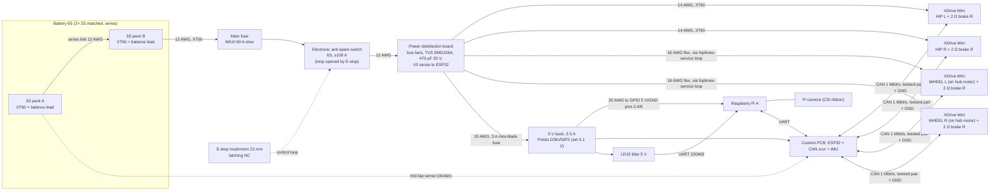

# Electrical Analysis — P1 (calculations and research only, no CAD)

Author: Electrical Engineer · Date: 2026-11-04 · Status: P1 draft for Gate B
Inputs read: DECISIONS.md, PLAN.md, Requariment.txt, BOM File.txt, driver drawing `S7069865348f64e5ca6d538db24917394P.webp`, motor drawing `51fNBSpzq5L.jpg`.

---

## 1. Summary

| Question | Answer | Confidence |
|---|---|---|
| Does the MKS XDrive Mini accept 6S (25.2 V full)? | **Yes. No blocker.** The official Makerbase schematic uses 60 V MOSFETs (onsemi NTMFS5C628NL), a DRV8301 gate driver (60 V operating, 65 V abs. max) and 63 V bulk capacitors. The rated input is 12–56 V. At 25.2 V the margin to the weakest part is 60/25.2 = **2.4×**. | High (schematic + photo of the board) |
| Is regenerative braking a risk on 6S? | **Not a blocker.** Traction limits braking to ~100 W mechanical for the whole robot, so realistic regen is **< 10 A** into the bus. A 2200 mAh pack absorbs that as a short pulse. The real risks are: (a) **the battery disconnects while motors move** (fuse, e-stop, connector) — the bus goes from 25.2 V to the 30 V trip in ~3 ms; (b) **bench tests on a lab power supply**, which cannot sink current. | Medium (calculated, needs a measured log in P6a) |
| Brake resistor | **2 Ω, ≥25 W aluminium-clad, one per driver on the AUX terminal** (4 total, ~40 g). Use the over-voltage ramp at 26–28 V and trip at 30 V. The config is in §3.3. | High for the method, medium for the value |
| Series 2×3S absorbing regen | Acceptable **only if the packs are a matched pair** and are balance-charged separately before every session. The same current flows through both packs, so the pack with the higher state of charge reaches 4.2 V/cell first. **Recommended change: one 6S pack**, or keep 2×3S with per-pack voltage monitoring. | High |
| Motor compatibility (Eaglepower 8308) | Compatible (ODrive "HIGH_CURRENT" motor type). **KV is not confirmed.** The family is sold as KV 90/130/160/180/205. Only KV90 has a published resistance: 0.186 Ω, from one unverified listing. Community configs use **20 pole pairs** for the LA8308. Measure R and the pole count on the real motor. | Medium/low (no official datasheet exists) |
| **Biggest integration finding** | **The AS5047P encoder is soldered to the XDrive Mini itself.** The board must sit **coaxially on the back of each motor**, with a diametric magnet on the rotor shaft end and a 1.0–2.0 mm air gap. This means **each wheel driver rides on the leg at the hub motor**. Power plus CAN (4–5 wires) then cross the hip and knee instead of 3 phase wires plus a 6-wire SPI encoder cable. The CAD team must reserve this space now. | High |
| Battery current | Continuous ~40 W → **~1.8 A** average. Jump peak ≈ **60–100 A for < 0.3 s** (hip motors at current limit). Wheel-only driving peaks ≈ 20–30 A. | Medium (depends on Theory's jump profile) |
| Recommended battery | 2× 3S 2200 mAh ≥50C, matched pair (≈ 2×185 g), or one 6S 2200 mAh (≈ 340 g). 48.8 Wh → **~45–60 min** of mixed use, ~25 min of aggressive use. | Medium |
| Electrical mass (excluding motors) | **≈ 0.95 kg** (table §5.1). Motors add 4×~330 g = 1.32 kg, so electrical plus motors ≈ **2.27 kg, i.e. 57 % of the 4.0 kg limit**. Flag to the BOM engineer. | Medium |

**Blockers: none.** Major risks: an unconfirmed motor KV and resistance; the on-board encoder forcing the driver onto the motor; hip output position being ambiguous through the gearbox (needs homing); the connector and fuse rating for the jump pulse.

---

## 2. Assumptions

| # | Assumption | Source / reason | Owner to confirm |
|---|---|---|---|
| A1 | Pack = 2× 3S LiPo in series: 6S, 22.2 V nominal, 25.2 V full, 21.0 V soft cutoff (3.5 V/cell loaded), 18.0 V hard cutoff (3.0 V/cell) | DECISIONS.md | Client |
| A2 | Robot mass 4.0 kg (worst case), wheel Ø170 mm (r = 0.085 m), top speed 12 km/h = 3.33 m/s | PLAN.md §3–4 | Theory |
| A3 | Wheel gear ratio 4–6:1 and hip ratio ~9:1 | PLAN.md §3 | Theory |
| A4 | Motor KV between 90 and 205. Calculations use a KV range, with KV90 as the worst case for current and KV205 for speed | DECISIONS.md (KV90 not confirmed) | Theory / measurement |
| A5 | Line-to-line resistance R_ll(KV90) = 0.186 Ω (unverified listing). Other KVs are scaled as R ∝ 1/KV² (same copper fill) | §4 sources | Measure on the bench |
| A6 | 20 pole pairs (40 magnets, likely 36N40P) | Community LA8308 config | Count magnets |
| A7 | Driver firmware = Makerbase fork of ODrive **v0.5.1** (`MKS_ODrive_MINI_0_5_1_20250326.bin`). Config names below are checked against the ODrive fw-v0.5.1 source | Makerbase GitHub | Electrical on first power-up |
| A8 | Tyre–floor friction μ = 0.8 (TPU on indoor floor) | Typical | Materials |
| A9 | Driver mass ≈ 40 g with screw terminals (not published) | Estimate | Weigh on arrival |
| A10 | Rated currents for XT60/XT30 connectors are typical vendor values (XT60 30 A continuous, XT30 15 A continuous) | Vendor typical | — |

---

## 3. Calculations

### 3.1 MKS XDrive Mini — verified specifications

| Item | Value | Source |
|---|---|---|
| Base design | ODrive v3.6 (56 V variant), **single axis**. Firmware still exposes a "ghost" axis1 | [S1][S3][S4] |
| MCU | STM32F405RG | [S5] |
| Gate driver | TI **DRV8301DCAR**, PVDD operating 6/8–60 V, **abs. max 65 V** | [S2][S9] |
| Power MOSFETs | 8× **onsemi NTMFS5C628NLT1G**, 60 V N-ch, ~2 mΩ class (6 for the bridge, 2 for the AUX brake chopper) | [S2] |
| Bulk capacitors | **100 µF / 63 V** electrolytic, 10×10.2 mm (5 visible on the V1.0 board photo ≈ 500 µF) | [S2][S6] |
| Small ceramics on bus | 4.7 µF 63 V, 100 nF 100 V | [S2] |
| Current shunts | **0.5 mΩ 1 %**, low side, 2 phases (B, C), DRV8301 amp gain up to 80× | [S2][S5] |
| Rated input voltage | **12–56 V** | [S7][S8] (Makerbase manual via manuals.plus / retailer) |
| Rated current | 60 A "working", 120 A peak (vendor claim; one third-party guide says 50 A continuous). **Treat ~40 A peak phase as the practical limit without a heatsink** | [S7][S8][S10] |
| Motor types | 3-phase BLDC/PMSM (ODrive `MOTOR_TYPE_HIGH_CURRENT` or `GIMBAL`) | ODrive fw |
| Encoder | **AS5047P on board** (14-bit, SPI, CS = GPIO7, CPR 16384). External ABZ/Hall header also available | [S2][S3][S4] |
| Interfaces | **CAN** (JST 2-pin, transceiver SN65HVD232 per schematic, **120 Ω termination DIP switch on board**), **USB-C** (DFU and odrivetool), **UART** on GPIO1/2, SWD header, SPI header, ABZ/Hall header, GPIO 1–4 header | [S2][S6] |
| Brake resistor output | **AUX ± terminal (2-pin screw)**. The vendor photo shows a gold aluminium-clad resistor connected | [S6] |
| Thermistor | On-board FET thermistor (M0_TEMP), plus an AUX_TEMP input | [S2] |
| Firmware | Makerbase fork of **ODrive 0.5.1** (2025-03-26 build). **Do not run `odrv0 upgrade` in odrivetool**: stock 0.5.1+ images brick it (ST-Link recovery). A community 0.5.6 port and a SimpleFOC firmware exist | [S1][S3][S11] |
| Dimensions | **63 × 58 mm**, 6× Ø3.3 mm holes, pattern **56.6 × 51.5 mm**, middle holes at 24.0 / 27.5 mm from the ends (project drawing) | webp drawing, [S6] |
| Height | ≈ 25 mm with screw terminals (estimate from photo; capacitors are 10.2 mm, terminal blocks ~15 mm). Soldering the leads directly roughly halves this [S10] | Estimate |
| Mass | Not published, **est. 40 g** | A9 |
| Known quirks | Startup encoder and calibration noise: disable startup calibration and use `pre_calibrated`. CAN ID clash from the ghost axis1: set `axis1.config.can_node_id = 63`. Some boards have a CAN-transceiver Rs resistor too high (listen-only); fixed by shorting the pads [S10] | [S3][S4][S10] |

**6S check:**

| Part | Rating | At 25.2 V (full) | At 30 V (our OV trip) | Margin at full charge |
|---|---|---|---|---|
| MOSFET V_DS | 60 V | 42 % | 50 % | 2.38× |
| DRV8301 PVDD | 60 V operating / 65 V abs. max | 42 % | 50 % | 2.38× |
| Bulk caps | 63 V | 40 % | 48 % | 2.5× |
| Vendor input range | 12–56 V | inside | inside | — |

**Verdict:** 6S is well inside the safe range. 6S at 25.2 V sits at the low end of the board's range (the board is built for up to 12S). A third-party guide claiming "abs. max 28 V" [S10-b] contradicts the official schematic and photo and is rejected. **Check on arrival:** confirm that the capacitors on the boards delivered to us are marked 63 V (a cheaper 35 V variant would still pass at 25.2 V, but with a smaller margin).

### 3.2 Regenerative braking — energy and current

**Motor constants by KV variant.** ODrive convention: Kt = 8.27/KV in Nm/A. R is scaled from the unverified KV90 value (A5).

| KV | Kt (Nm/A) | Torque @ 40 A (Nm) | No-load rpm @ 22.2 V | @ 25.2 V | R_ll est. (Ω) | R_phase (Ω) |
|---|---|---|---|---|---|---|
| 90 | 0.092 | 3.68 | 1998 | 2268 | 0.186 | 0.093 |
| 130 | 0.064 | 2.54 | 2886 | 3276 | 0.089 | 0.045 |
| 160 | 0.052 | 2.07 | 3552 | 4032 | 0.059 | 0.029 |
| 180 | 0.046 | 1.84 | 3996 | 4536 | 0.047 | 0.023 |
| 205 | 0.040 | 1.61 | 4551 | 5166 | 0.036 | 0.018 |

Cross-check: a community test of an LA8308 **170 KV** on this exact driver measured ≈ 2.0 Nm at 50 A, i.e. 0.040 Nm/A [S10]. The formula predicts 0.049 Nm/A, so the measured value is ~82 % of ideal (saturation and losses). Use **0.8 × 8.27/KV** for design torque.

**Speed note for Theory:** at 12 km/h with a Ø170 wheel, the wheel turns 375 rpm, so the motor turns 1500/1875/2250 rpm at 4/5/6:1. With a loaded, sagging bus (~21 V) and ODrive modulation limits, usable speed is ≈ 0.8 × KV × V_bus. **KV90 gives ≈ 1510 rpm, which only just reaches 12 km/h at 4:1 and fails 10 km/h at 6:1.** KV ≥ 130 is needed for 5–6:1. The electrical side has no objection to a higher KV: current per torque rises, but stays within the driver.

**Case 1 — braking from top speed (wheel motors).** Kinetic energy: E = ½·m·v² = ½·4·3.33² = **22.2 J**. Wheel and rotor inertia add about +10 %, giving ~25 J. A balancing robot cannot brake harder than traction allows: F_max = μ·m·g = 0.8·4·9.81 = 31.4 N. Peak mechanical braking power = F·v = 31.4 × 3.33 = **105 W total** (52 W per wheel). Copper loss in the motors subtracts from this. So the bus sees **< 100 W, which is < 4 A at 25 V**.

**Case 2 — landing after a 20 cm jump (hip motors).** E = m·g·h = 4·9.81·0.20 = **7.85 J**, absorbed by springs plus hip motors over ~0.05–0.1 s. If the motors take all of it: P = 80–160 W across two hips, giving **≤ 6.5 A** at 25 V before copper losses. Copper loss at high current is large. KV90 at 40 A: P_cu = 1.5·I²·R_ph = 1.5·1600·0.093 = 223 W per motor, more than the regen. So hard landings mostly dissipate in the motor windings. The net bus current is small or even positive.

**Case 3 — theoretical worst case (motor forced to brake at full current at full speed, e.g. a spinning airborne wheel stopped at current limit).** Mechanical power = T·ω = 3.68 × (2250·2π/60) = 867 W. Minus copper loss of 223 W gives ≈ 640 W for < 50 ms. A free wheel has only ~ 0.5·J·ω² ≈ a few J of energy, so this lasts milliseconds. Peak ≈ 25 A per motor, but the energy is tiny (< 5 J).

**Battery acceptance:** a 2200 mAh pack at 1–2 C continuous charge takes 2.2–4.4 A, and pulses of 10 A (4.5 C) for < 1 s are acceptable. Pack internal resistance ≈ 6 cells × 5 mΩ + wiring 10 mΩ ≈ 40 mΩ. At full charge, a 10 A regen pulse raises the terminal voltage by ≈ 0.4 V (25.6 V, i.e. 4.27 V/cell for < 1 s), which is acceptable. **Conclusion: with the battery connected, regen is not a hazard on 6S.**

**Battery-disconnected case (the real hazard).** Bus capacitance ≈ 4 drivers × 500 µF + 470 µF on the distribution board ≈ 2.47 mF. The energy to rise from 25.2 V to 30 V is ½·C·(30² − 25.2²) = 0.5·0.00247·265 = **0.33 J**. A 100 W landing fills it in ~3 ms, and the OV trip then disarms all motors, so the robot falls.
- Without a brake resistor: the boards are protected (after the trip, rectified back-EMF stays below the bus voltage at design speeds: KV·rpm sized to the bus, < 30 V ≪ 60 V), but **control is lost**.
- With a 2 Ω resistor and the OV ramp: each board can sink 25²/2 ≈ 310 W, so 4 boards sink ~1.2 kW. This exceeds every case above, so the robot keeps control long enough to land and stop.

**Bench testing (P6a/P6b) on a lab PSU:** most lab supplies cannot sink current. **The brake resistor is mandatory for any test without the battery.**

### 3.3 Brake resistor sizing and ODrive configuration

- **Value: 2.0 Ω.** At 28 V, I = 14 A, which suits the small AUX screw terminal and the 60 V AUX MOSFET. The maximum sink is V²/R = 25.2²/2 = **318 W** (at 95 % duty, the 0.5.1 firmware limit), which covers Case 3. 2 Ω is also the ODrive 56 V-board firmware default [S12].
- **Power rating: 25 W aluminium-clad** (≈ 10 W in free air without a heatsink). Average dissipation is < 5 W. The worst event is ~25 J, which raises a ~10 g resistor by ≈ 3 K. A 50 W part (the ODrive standard) is fine if mass allows. Mount it on metal or in airflow, **never directly on PLA** (it can exceed 100 °C).
- **Quantity: one per driver (4 total).** In fw 0.5.1, each board only brakes its **own** axis regen (`brake_current = −Ibus_sum − max_regen_current`) [S12]. The voltage-based ramp acts on the shared bus but is flagged "experimental". One resistor per board is the standard, verified path.
- **Wire:** 18 AWG, ≤ 15 cm, twisted pair.

**Per-board config (odrivetool, Makerbase 0.5.1 — names verified against the fw-v0.5.1 source [S12]):**

```python
# --- board / bus ---
odrv0.config.brake_resistance = 2.0                  # set to the MEASURED value of the fitted resistor; 0 disables
odrv0.config.max_regen_current = 3.0                 # A sent back to the battery before the resistor takes over
odrv0.config.dc_max_negative_current = -10.0         # trip if more than 10 A of regen reaches the battery (resistor saturated or open)
odrv0.config.dc_max_positive_current = 35.0          # hip boards; 20.0 for wheel boards (caps total battery draw at ~110 A)
odrv0.config.enable_dc_bus_overvoltage_ramp = True   # experimental in 0.5.1, test on the bench first
odrv0.config.dc_bus_overvoltage_ramp_start = 26.0    # above 25.2 V full + ripple
odrv0.config.dc_bus_overvoltage_ramp_end = 28.0
odrv0.config.dc_bus_overvoltage_trip_level = 30.0    # default would be 1.07*56 = 59.9 V, far too high for a 6S LiPo
odrv0.config.dc_bus_undervoltage_trip_level = 18.0   # 3.0 V/cell hard floor; soft cutoff 21.0 V done in ESP32 software
# --- motor ---
odrv0.axis0.motor.config.motor_type = MOTOR_TYPE_HIGH_CURRENT
odrv0.axis0.motor.config.pole_pairs = 20             # VERIFY: count rotor magnets / 2
odrv0.axis0.motor.config.calibration_current = 8.0
odrv0.axis0.motor.config.resistance_calib_max_voltage = 2.0
odrv0.axis0.motor.config.requested_current_range = 60.0
odrv0.axis0.motor.config.current_lim = 30.0          # hip; 20.0 wheel. Raise to 40 only after thermal test P6a
odrv0.axis0.motor.config.torque_constant = 8.27 / KV # use the measured KV
odrv0.axis0.fet_thermistor.config.temp_limit_lower = 80
odrv0.axis0.fet_thermistor.config.temp_limit_upper = 100
# --- encoder (on-board AS5047P) ---
odrv0.axis0.encoder.config.mode = ENCODER_MODE_SPI_ABS_AMS
odrv0.axis0.encoder.config.abs_spi_cs_gpio_pin = 7
odrv0.axis0.encoder.config.cpr = 16384
odrv0.axis0.config.startup_encoder_offset_calibration = False   # Makerbase noise quirk
odrv0.axis0.config.startup_closed_loop_control = False          # ESP32 arms the axes deliberately
# after one offset calibration on the bench (motor free to turn):
odrv0.axis0.encoder.config.pre_calibrated = True
odrv0.axis0.motor.config.pre_calibrated = True
# --- CAN ---
odrv0.axis0.config.can_node_id = <0..3>
odrv0.axis1.config.can_node_id = 63                   # silence the ghost axis
odrv0.can.set_baud_rate(1000000)                      # see CAN load below
odrv0.save_configuration(); odrv0.reboot()
```

Note: 0.5.1 has **no** `enable_brake_resistor` flag (it arrived in 0.5.2+). Braking is active whenever `brake_resistance > 0`. **If no resistor is fitted, set `brake_resistance = 0`.** Otherwise the firmware assumes a resistor is sinking current and the bus rises unchecked until the OV trip.

**CAN load:** 4 axes × (1 torque command + 1 encoder estimate) × 500 Hz = 4000 frames/s × ~130 bit = 520 kbit/s. **This requires 1 Mbit/s** (52 % load) and does not fit at 500 kbit/s. Terminate with 120 Ω at the ESP32 end and on the last driver (DIP switch).

### 3.4 Motor ↔ driver compatibility

| Item | Value | Status |
|---|---|---|
| Variants | KV 90 / 130 / 160 / 180 / 205 (LA8308 family) [S13][S14] | Confirmed that variants exist |
| Mass | 325–336 g (KV90 listings; one listing says 350 g, likely packed) [S14][S15] | Medium |
| Dimensions | Ø92 × 28.5 mm, 6 mm shaft [S15], stator 4×M4 on Ø40, rotor 4×M3 on Ø40 | Drawing + listing |
| Voltage | 6S–12S [S15] — 6S is at the lower end, so speed is limited (see §3.2) | — |
| Current | 22 A continuous (with propeller airflow) / ~40–45 A max [S14][S15] | Conflicting listings |
| Phase resistance | 0.186 Ω (KV90, single listing that also contradicts itself) [S16] | **Unverified, must be measured** |
| Pole pairs | 20 (community LA8308 config) [S3] | Verify by counting magnets |
| Driver match | ODrive current range 60 A ≥ motor max 45 A. Low R needs `resistance_calib_max_voltage` ≈ 2 V | OK |
| Electrical frequency | At 2250 rpm × 20 pp / 60 = **750 Hz**. The ODrive current loop at ~8 kHz gives ~11 samples per electrical cycle, which is adequate. Do not exceed ~3000 rpm motor speed with 20 pole pairs | OK, keep in mind |
| Continuous current in robot | No propeller airflow: **derate to ≈ 10–12 A RMS continuous** (est. 30–50 %) until the thermal engineer confirms | Thermal to confirm |

**Bench measurements required (P6a, before freezing gear ratios):** (1) phase resistance and inductance (ODrive `AXIS_STATE_MOTOR_CALIBRATION` reports `phase_resistance` and `phase_inductance`); (2) KV, by spinning at a known rpm and measuring line-to-line back-EMF, or from ODrive `vel_estimate` versus `Iq`/`Vq`; (3) count the magnets; (4) weigh the motor.

### 3.5 Encoder mounting (requirement for the CAD team)

The AS5047P is soldered **on the XDrive Mini PCB**. A Makerbase photo [S6] shows the board mounted directly behind a 36-slot outrunner, and a community STEP file exists for "LA8308 motor mount and driver assembly" [S3].

| Requirement | Value |
|---|---|
| Magnet | **Diametrically magnetised NdFeB, Ø6 × 2.5 mm** (AS5047P eval-kit magnet), or Ø8 × 3 mm N35H (datasheet reference magnet) [S17] |
| Attachment | Glued or pressed in a non-magnetic holder (aluminium, brass, or printed) on the **rotor shaft end on the stator side**, concentric to ±0.25 mm |
| Air gap (magnet face → AS5047P package top) | **1.0–2.0 mm**, nominal 1.5 mm for Ø6 (2.0 mm for Ø8). Allowed range 0.5–3 mm [S17] |
| Board underside → magnet face | ≈ air gap + package height (~1.1 mm), so **≈ 2.1–3.1 mm**. Standoffs set this; make it adjustable with shims |
| Sensor position on the board | **Must be measured on the real board** (believed to be at the board centre, underside). CAD keeps the sensor centre on the motor axis within ±0.5 mm |
| Adapter | 63 × 58 board holes (56.6 × 51.5 pattern, M3) ↔ motor stator 4×M4 on Ø40: adapter plate with a **central Ø≥12 mm clearance hole** for the magnet. **Non-magnetic screws and standoffs within ~10 mm of the sensor** |
| Shaft check | **Open:** confirm that the 8308 shaft end is reachable through the stator base (normally retained by an E-clip). If not, mount the magnet on a carrier fixed to the rotor bell |
| Joint-angle ambiguity | The AS5047P is absolute only over **one motor turn**. Through a 9:1 hip gearbox the leg angle is ambiguous across 9 motor turns, so the leg needs **homing to a hard stop at boot** or a second absolute encoder on the hip output. Flag for Control |

### 3.6 Battery current and runtime

**Continuous (driving at 12 km/h on flat ground plus balancing):**

| Load | Power |
|---|---|
| Rolling resistance: Crr 0.03 × 4 × 9.81 × 3.33 m/s | 3.9 W |
| Balancing and acceleration transients (est.) | 10–15 W |
| Hip holding: ~1–2 Nm per hip through 9:1 at η 0.85 → 1.5–3 A per motor → copper loss | 1–2 W |
| Motor and driver losses (est.) | 8 W |
| 4× XDrive Mini quiescent (MCU + DRV8301 + gate drive, est. 1.5 W each) | 6 W |
| Raspberry Pi 4 (SLAM, Wi-Fi) | 4–6 W |
| LD19 lidar (5 V, 180 mA) [S18] | 0.9 W |
| Pi camera | 1.3 W |
| ESP32 + CAN + IMU | 0.7 W |
| Buck converter loss (90 %) | 0.9 W |
| **Total (design)** | **≈ 40 W, i.e. 1.8 A at 22.2 V** |

**Peaks:**
- Jump (both hip motors at 30–40 A phase, plus wheels balancing): hip electrical power per motor ≈ T·ω + P_cu ≈ 3.7 Nm × ~120 rad/s + 220 W ≈ 650 W. Two hips plus 2 × 100 W of wheels gives ≈ 1.5 kW, i.e. **≈ 60–100 A for < 0.3 s** (capped by `dc_max_positive_current`: 2×35 + 2×20 = 110 A).
- Hard acceleration while driving: ≈ 20–30 A.

**Recommended pack:** 2× 3S **2200 mAh ≥ 50C** (nominal 110 A; real-world sustained ≈ 50–60 A, with 100 A bursts acceptable), matched pair. Energy = 2.2 Ah × 22.2 V = 48.8 Wh, of which 80 % usable = 39 Wh.

| Use | Average power | Runtime |
|---|---|---|
| Standing, balancing, mapping | 25 W | ~94 min |
| Mixed driving (design) | 40 W | **~59 min** |
| Aggressive (jumps, climbing) | 80 W | ~29 min |

Lighter option: 2× 3S 1500 mAh 75C (≈ 2×130 g, saves ~110 g) gives ~40 min mixed. This is the BOM engineer's choice under the mass budget.

### 3.7 Power distribution



| Segment | Max current | Wire (silicone, fine-strand) | Connector | Protection |
|---|---|---|---|---|
| Pack ↔ pack series link, pack → fuse → switch → PDB | 100 A for 0.3 s, ~2 A average | **12 AWG** (≈ 38 g/m) | XT60 (packs normally come with XT60). XT90-S is an alternative that adds anti-spark | **Main fuse MAXI 60 A slow** (Littelfuse 299 series). Verify its time–current curve against the measured jump pulse in P6e |
| PDB → hip drivers | 35 A (software limit), ~1 A average | **14 AWG**, ≤ 25 cm | XT60 (XT30 is only 15 A continuous — too small) | Main fuse covers 14 AWG at short length |
| PDB → wheel drivers (through hip and knee) | 20 A (software limit) | **16 AWG high-flex** (≥ 250 strands), ≤ 50 cm | XT30 acceptable at 20 A peak (lighter), or soldered | Main fuse |
| Brake resistors | 14 A peak | 18 AWG | Screw terminal (AUX) | — |
| 5 V buck input | 1.5 A | 20–22 AWG | JST-XH or soldered | **3 A mini-blade fuse** (thin wire needs its own fuse) |
| 5 V → Pi 4 | 3 A | 20 AWG, ≤ 15 cm | GPIO 5 V pins (2, 4) + GND (6) or USB-C | Pi's own polyfuse is bypassed on GPIO, so keep the buck current limit |
| CAN | — | 24–26 AWG twisted pair + GND | JST-GH / the driver's JST | 120 Ω at both ends |

**Over-voltage clamp:** an SMDJ26A TVS (26 V standoff, ~29 V breakdown, ~42 V clamp, 3 kW pulse) across the bus on the PDB catches switching spikes. It is not a regen sink; the brake resistors are.

**E-stop concept:** two layers.
1. **Soft stop:** an RC/Wi-Fi kill or the ESP32 sends `estop` over CAN to all axes. The robot squats or falls under control.
2. **Hard stop:** a latching mushroom switch opens the control loop of the **electronic anti-spark switch**, which disconnects the battery. The brake resistors and OV ramp keep the bus below 30 V while the motors spin down. A mushroom contact must **not** carry the 100 A motor current directly.

**Pre-charge:** the bus capacitance is ~2.5 mF. Connecting at 25 V without the anti-spark switch causes a spark and inrush that pits XT60 contacts. The electronic switch (or XT90-S) prevents this.

### 3.8 LiPo safety

1. **Matched series pair:** same brand, model, capacity, C rating, purchase batch and cycle count. Label them as a pair (A1/A2) and never mix pairs. Before each session check that the per-pack voltages agree within 0.05 V/cell and the internal resistance within 20 %.
2. **Balancing:** packs in series are **not** balanced against each other by the robot. Balance-charge each 3S pack separately (split the series harness), or use a 2×3S → 6S balance adapter on a 6S balance charger. Never bulk-charge the series pair through the main leads.
3. **On-robot monitoring:** the ESP32 measures the series mid-tap (pack A) and the total (from ODrive `vbus_voltage` over CAN, or a second divider), so pack B = total − A. Thresholds:
   - Warning: any pack below 3.6 V/cell loaded, or a difference > 0.1 V/cell.
   - Soft cutoff (land, stop jumping, park): 3.5 V/cell loaded, i.e. 21.0 V total.
   - Hard trip in ODrive: 18.0 V.
   
   A cheap 8 g LiPo cell-checker buzzer on each balance lead is a good backup during tests.
4. **Charging:** balance charger at ≤ 1 C (2.2 A), in a LiPo bag or metal box, on a non-flammable surface, attended, **never inside the robot**. Do not charge a puffed, punctured or hot pack. Let packs cool after a run first.
5. **Storage:** 3.80–3.85 V/cell (charger storage mode) if unused for more than 2 days. Keep in a fire-resistant LiPo bag or a vented (not sealed) metal ammo box, away from flammables, at 10–25 °C.
6. **In the robot:** packs are held in a padded cradle with a strap rated for 5 g landings. Keep packs away from screw tips and sharp printed edges, and give the balance leads strain relief. Fit a puncture shield (≥ 1 mm PETG or aluminium) under the packs if the body can hit the ground.
7. **Damaged pack disposal:** discharge slowly to 0 V through a resistor load outdoors, then take it to battery recycling.
8. **Test discipline:** do the first power-up of each driver from a current-limited supply (with the brake resistor fitted) before connecting the LiPo.

### 3.9 Driver thermal estimate (for the Thermal engineer)

At 20 A peak phase current: I_rms = 14.1 A per phase. Conduction loss = 3 × 14.1² × ~3.6 mΩ (hot R_DS(on)) = 2.2 W, plus switching ~1 W, shunts 0.3 W, logic ~1.5 W, giving **≈ 5 W per board continuous**. At 40 A for jump bursts ≈ 12–15 W for a few seconds.

Community users report that the stock board needs extra heatsinking under sustained high torque, and that **the motor overheats before the driver** [S10].

Requirements:
- An aluminium plate of ≥ 1.5 mm, or a thermal pad to the adapter plate, under the MOSFET area.
- ≥ 5 mm air gap to any PLA surface.
- Vent openings in the electronics bay.
- `fet_thermistor` limits 80/100 °C.

---

## 4. Sources (URLs)

| ID | Source |
|---|---|
| S1 | Makerbase official repo (firmware + hardware), MKS ODrive MINI: https://github.com/makerbase-motor/MKS-ODrive — firmware `Firmware/MKS ODrive MINI/MKS_ODrive_MINI_0_5_1_20250326.bin` |
| S2 | **Official schematic** "MKS ODRIVE MINI V1.0 Schematic.pdf": https://raw.githubusercontent.com/makerbase-motor/MKS-ODrive/master/Hardware/MKS%20ODrive%20MINI/MKS%20ODRIVE%20MINI%20V1.0%20Schematic.pdf (parts read: NTMFS5C628NLT1G ×8, DRV8301DCAR, 100 µF 63 V, 0.5 mΩ shunt, SN65HVD232DR, AS5047, AUX brake) |
| S3 | Community setup guide + LA8308 config + LA8308 motor/driver STEP: https://github.com/justlovescience/MKS-XDRIVE-MINI (my_config.txt; pole_pairs 20 for LA8308 170 KV; "do not upgrade") |
| S4 | XDrive Mini quirks (startup noise, SPI CS = GPIO7): https://github.com/Smurf/xdrive-mini-docs |
| S5 | SimpleFOC firmware for XDrive Mini (MCU, DRV8301, 0.5 mΩ shunt, 80× gain, CAN pins): https://github.com/simplefoc/mks_xdrive_mini_firmware |
| S6 | Makerbase pinout/drawing images (AUX brake resistor, 63 V caps, 120 Ω switch): https://raw.githubusercontent.com/Smurf/xdrive-mini-docs/main/img/XDrive-mini-pinout.png and project file `S7069865348f64e5ca6d538db24917394P.webp` |
| S7 | Makerbase MKS XDrive Mini user manual (12–56 V, 60 A / 120 A): https://manuals.plus/ae/1005006480243178 (returned 403 to direct fetch; values from search index) |
| S8 | Makerbase product page: https://makerbase3d.com/product/makerbase-xdrive-mini-high-precision-brushless-servo-motor-controller-based-on-odrive3-6-with-as5047p-on-board/ ; retailer https://www.robotics.org.za/MKS-ODRIVE-S |
| S9 | TI DRV8301 datasheet (PVDD 65 V abs. max, 6–60 V operating): https://www.ti.com/document-viewer/DRV8301/datasheet/specifications ; TI E2E: https://e2e.ti.com/support/motor-drivers-group/motor-drivers/f/motor-drivers-forum/366954/drv8301-absolute-maximum-ratings |
| S10 | Hackaday XDrive Mini guide (fw v0.5.1, LA8308 170 KV: 2 Nm at 50 A, thermal notes, CAN Rs fix): https://hackaday.io/project/204985-mks-xdrive-mini-guide-set-up-tuning-arduino ; S10-b (rejected "28 V abs. max" claim): https://industrialmonitordirect.com/blogs/knowledgebase/odrive-36-clone-setup-can-bus-arduino-motor-tuning-guide |
| S11 | Community ports: https://github.com/NEIK197/ODrive-0.5.6-for-MKS-XDrive-Mini , https://github.com/omletkang/xdrive-mini-fw-instant-start |
| S12 | ODrive fw-v0.5.1 source: config defaults https://github.com/odriverobotics/ODrive/blob/fw-v0.5.1/Firmware/MotorControl/odrive_main.h , brake logic `update_brake_current()` https://github.com/odriverobotics/ODrive/blob/fw-v0.5.1/Firmware/MotorControl/low_level.cpp , interface https://github.com/odriverobotics/ODrive/blob/fw-v0.5.1/Firmware/odrive-interface.yaml ; ODrive docs (brake resistor / dc_max_negative_current) https://docs.odriverobotics.com/v/0.5.6/getting-started.html |
| S13 | Eaglepower 8308 KV variants: https://www.alibaba.com/product-detail/Eaglepower-8308-Brushless-Motor-KV90-KV130_1601254736691.html , https://tyi-model.en.made-in-china.com/product/cTaUGCjrvERv/China-Eaglepower-La8308-Brushless-Motor-90kv-130kv-160kv-180kv-205kv-High-Power-Loading-Waterproof-Large-Agricultural-Drone-Uav-Hly-W9225.html |
| S14 | Robu LA8308 KV90 (22 A cont., 900 W, 0.186 Ω): https://robu.in/product/eaglepower-la-8308-kv90-motor/ |
| S15 | Technobotix LA8308 KV90 (6S–12S, 40–45 A max, ~325 g, 6 mm shaft): https://www.technobotix.in/blogs/post/eagle-power-la-8308-kv90-brushless-motor-%E2%80%93-unmatched-power-for-heavy-lift-drones |
| S16 | IndiaMart LA8308 KV90 (0.186 Ω; listing self-contradictory): https://www.indiamart.com/proddetail/eagle-power-la-8308-kv90-motor-2856479923097.html |
| S17 | ams AS5047P datasheet (reference magnet Ø8×3 N35H): https://dtsheet.com/model/4680504 ; AS5047P adapter-board magnet Ø6×2.5 diametric: https://www.mouser.lt/pdfdocs/ams_AS5047D_TS_EK_AB_OperationManual_Rev11.PDF ; air gap 0.5–3 mm, nominal 1.5/2 mm (ams family guidance) |
| S18 | Waveshare LD19 wiki (5 V, 180 mA, 38.59×38.59×33.5 mm, UART 230400): https://www.waveshare.com/wiki/DTOF_LIDAR_LD19 |
| S19 | Pololu D36V50F5 5 V 5.5 A buck (5.5–50 V in, 25.4×25.4×9.5 mm, 3× M2 holes): https://www.pololu.com/product/4091 |

---

## 5. Data for the CAD and BOM teams

### 5.1 Electrical parts — size, mass, mounting, cooling

Masses marked "est." must be weighed on arrival.

| Part | Qty | Size (mm) | Mass each (g) | Total (g) | Mounting | Cooling / notes |
|---|---|---|---|---|---|---|
| MKS XDrive Mini V1.0 | 4 | 63 × 58 × ~25 (with terminals) | 40 (est.) | 160 | 6× Ø3.3 holes, pattern 56.6 × 51.5 (middle holes 24 / 27.5 from ends), M3. **Coaxial on the motor back** (AS5047P) via an adapter plate | ~5 W continuous, 15 W bursts; Al plate or thermal pad under the FETs; ≥ 5 mm from PLA; vents |
| Brake resistor 2 Ω 25 W Al-clad (e.g. Arcol HS25 2R0) | 4 | ~30 × 15 × 9 body, tab holes ~ M3 | 10 (est.) | 40 | 2× M3 on metal (the driver adapter plate) | Surface can exceed 100 °C; no PLA contact |
| LiPo 3S 2200 mAh 50C (2× in series) | 2 | ~106 × 34 × 27 | 185 (est.) | 370 | Padded cradle + strap (5 g landing) on the CoM trim rail | Keep < 60 °C; puncture shield |
| (alt.) LiPo 6S 2200 mAh 50C single pack | 1 | ~106 × 34 × 50 | 340 (est.) | 340 | Same | Recommended alternative |
| Main fuse MAXI 60 A + inline holder | 1 | ~45 × 30 × 20 | 15 (est.) | 15 | Cable-mounted, clip to body | Must be reachable for replacement |
| Electronic anti-spark switch 6S ≥100 A | 1 | ~45 × 25 × 12 | 18 (est.) | 18 | Double-sided tape / M2 | Small heat at 100 A peak |
| E-stop latching mushroom (22 mm panel) | 1 | Ø40 head, 22 mm hole, ~45 deep | 30 (est.) | 30 | Top cover, 22.3 mm panel hole, ≤ 6 mm wall | Must be reachable from outside |
| Power distribution board (bus bars, TVS, 470 µF/35 V, mid-tap sense, 3 A fuse) | 1 | ~50 × 40 × 15 | 25 (est.) | 25 | 4× M3 | — |
| 5 V buck Pololu D36V50F5 | 1 | 25.4 × 25.4 × 9.5 | 7 (est.) | 7 | 3× M2 (Ø2.2 holes) | ~1 W; airflow |
| Raspberry Pi 4 (+ heatsink) | 1 | 85 × 56 × ~20 | 46 + 10 | 56 | 4× M2.5, holes 58 × 49 | 3–6 W; heatsink, vent or 30 mm fan; throttles at ~80 °C |
| Custom PCB (ESP32 + CAN transceiver + IMU + connectors) | 1 | ~65 × 56 × 12 (est., Pi-HAT size) | 25 (est.) | 25 | Stack on Pi standoffs M2.5 | IMU near the CoM, rigidly mounted (Control) |
| Pi camera (v2 / v3) | 1 | 25 × 24 × 9 / 11.5 | 3–4 | 4 | 4× M2, holes 21 × 12.5 | Ribbon cable ≤ 30 cm |
| LD19 lidar | 1 | 38.6 × 38.6 × 33.5 | 47 | 47 | Bottom plate, 4 screws (take from the LDROBOT 3D model) | 0.9 W; 360° clear view |
| Wiring harness + connectors (12/14/16/18/20 AWG, CAN, XT60/XT30 ×~10, heat-shrink) | 1 lot | — | — | 150 (est.) | Cable clips every 50 mm | — |
| **Electrical total (2× 3S option)** | | | | **≈ 947 g** | | |
| Eaglepower 8308 motors (for reference; BOM owns them) | 4 | Ø92 × 28.5 | 325–336 | ~1320 | Stator 4×M4 on Ø40; rotor 4×M3 on Ø40 | Derate without propeller cooling |

### 5.2 Space and routing requirements

1. **Driver location:** each XDrive Mini is fixed coaxially to the **stator side of its own motor** on an adapter plate.
   - Hip drivers sit in the body at the hip.
   - Wheel drivers sit **on the shank / hub, inboard of the wheel, not rotating with it**. They add ~50 g of unsprung mass per side (board + resistor), and the Theory engineer must include this.
   - Each driver needs a 70 × 65 mm footprint, ~30 mm of depth behind the motor, an IP-style printed cover with vents, and a magnet carrier on the shaft.
2. **Cable path through the rotating hip and knee:** each wheel driver needs 2× 16 AWG power + CAN twisted pair + GND (4 conductors, bundle Ø ≈ 7 mm).
   - Joint rotation is limited (< ±150°), so **no slip ring** is needed. Use a **service loop or clock-spring** with ≥ 25 mm bend radius, routed **through or next to the hip axis** (hollow hip shaft Ø ≥ 10 mm preferred).
   - Clamp both sides of each joint and use high-flex silicone wire.
   - Check the knee and four-bar coupler joints the same way.
   - **CAD must model this loop and check it does not pinch at full fold or full extension.**
3. **Rejected alternative** (drivers in the body, phases routed to the wheel): 3× 16 AWG phase wires + 6-wire SPI encoder cable through the joints. SPI over ~0.5 m next to PWM phase wires is noise-prone, and this option needs a separate AS5047P breakout at each hub motor. Not recommended.
4. **Batteries:** low and central on the CoM trim rail; the balance leads must be reachable without disassembly. The main fuse, anti-spark switch and e-stop sit near the top cover.
5. **Bay ventilation:** total heat in the body is ≈ 2 hip drivers × 5 W + Pi 5 W + buck 1 W ≈ 16 W continuous. The Thermal engineer must check that PLA walls stay < 50 °C.

---

## 6. Open questions

1. **Exact KV, phase resistance, pole count and mass of the purchased 8308 motors.** Measure on arrival; this blocks the final gear ratio (Theory).
2. Is a brake resistor included in the XDrive Mini box? (The vendor photo shows one.) If yes, record its value and wattage.
3. The AS5047P location on the board (centre? underside?) and the 8308 shaft-end access through the stator base. Measure the physical parts before CAD of the adapter plates.
4. Do the delivered boards have 63 V capacitors (as in the V1.0 schematic and photo)?
5. CAN transceiver: is it SN65HVD232 (schematic) or HVD230 with the Rs issue [S10]? Test CAN on every board at 1 Mbit/s.
6. Does the Makerbase 0.5.1 fork keep `enable_dc_bus_overvoltage_ramp` and `fet_thermistor`? Check with odrivetool tab-completion on the first board.
7. Jump current profile: Theory/Control must provide hip torque–speed versus time so the main fuse time–current curve and the pack C rating can be confirmed (P6e measurement).
8. Hip joint absolute position: homing to a hard stop, or an output encoder? (Control.)
9. Single 6S pack versus 2× 3S: client decision (see §7).

---

## 7. Changes to design assumptions

| # | Previous assumption | Change / recommendation | Reason |
|---|---|---|---|
| C1 | Drivers in the central body bay, "near their motors" (PLAN §3) | **Each driver mounts coaxially on its motor** (on-board AS5047P). Wheel drivers ride on the leg at the hub | The encoder is on the driver PCB |
| C2 | Phase wires routed to the wheel motors | **Only power (2× 16 AWG) + CAN (3 wires)** cross hip and knee via a service loop; no slip ring | Fewer, more robust wires; no long SPI |
| C3 | No brake resistor in the BOM | **Add 4× 2 Ω 25 W resistors + OV config (26/28/30 V)**; mandatory for bench-PSU tests | Battery-disconnect and PSU cases |
| C4 | 2× 3S in series | Allowed only as a **matched pair with separate balance charging and mid-tap monitoring**; a single 6S pack is recommended | Series packs are not balanced against each other |
| C5 | ODrive defaults | OV trip 59.9 V → **30 V**; UV 8 V → **18 V**; the CAN bus needs **1 Mbit/s** | 6S LiPo protection; CAN load |
| C6 | KV90 implied 12 km/h is reachable | KV90 on 6S reaches only ~1500 rpm under load, so **KV ≥ 130 is needed for ratios 5–6:1** (to Theory) | Back-EMF limit |
| C7 | Unsprung wheel mass = motor + gearbox + wheel | **+~50 g per wheel** (driver + resistor + cover) | C1 |
| C8 | Electrical mass not budgeted separately | **≈ 0.95 kg electrical + 1.32 kg motors = 2.27 kg** (57 % of 4.0 kg) | §5.1 table, for BOM |
| C9 | Hip angle known from the motor encoder | The hip needs **homing or an output encoder** (motor encoder is absolute over one turn only) | 9:1 gearbox |

---

## P1 follow-up (O9) — new wheel motor, hip KV130, single 6S pack (rev 2, 2026-11-04)

Inputs: DECISIONS.md (rows for hips 8308 KV130, light wheel motor, one 6S 2200 mAh 50C pack) and theory.md "P1 follow-up (O9)":
- Wheel: T-Motor MN5008 KV170, 128 g, 270 mΩ line-to-line, 24N28P (14 pole pairs), 15 A peak, 3.5:1 gearbox.
- Hips: 8308 KV130, 8:1, 40 A peak, ≤ 56 A from the battery for ≈ 70 ms per jump.

Firmware facts below were checked in the ODrive fw-v0.5.1 source (`motor.cpp`, `encoder.cpp`, `low_level.cpp`), which the Makerbase fork is based on.

### O9-a. MN5008 KV170 on the MKS XDrive Mini — compatible

| Check | Value | Result |
|---|---|---|
| Motor class | R_ll 0.270 Ω → R_phase ≈ 0.135 Ω. This is a normal low-R multirotor motor, **not gimbal-class** (gimbal motors are 5–15 Ω). Use `MOTOR_TYPE_HIGH_CURRENT` with current sensing; `MOTOR_TYPE_GIMBAL` is not needed | OK |
| Resistance calibration | fw 0.5.1 raises `PHASE_RESISTANCE_OUT_OF_RANGE` if the test voltage exceeds `resistance_calib_max_voltage`. With I_cal = 5 A: V = 5 × 0.135 = 0.68 V, so set max_voltage = 2.0 V (≈ 3× headroom) | OK |
| Inductance window | fw 0.5.1 accepts **2 µH–4000 µH** (`motor.cpp` line 277). A Ø55 motor with 24N28P is expected at tens to hundreds of µH; **measure it**. PWM ripple (24 kHz, 25 V, worst duty) ≈ 13 / 5.2 / 2.6 A pk-pk at L = 20 / 50 / 100 µH. **Accept if L ≥ 50 µH** (ripple < 35 % of the 15 A peak). If L < 30 µH, flag it: extra heating and noisy current loop | OK pending measurement |
| Current range | 15 A peak. Set `requested_current_range = 20` (the firmware then picks the highest amplifier gain, ≈ ±40 A full scale, ~20 mA per ADC count), `current_lim = 15`, `current_lim_margin = 5` (trips at 20 A) | OK |
| Pole pairs | 14. Electrical frequency at 12 km/h: 375 × 3.5 = 1313 rpm → **306 Hz**. At 25.2 V no-load (4284 rpm) → 1000 Hz. The ~8 kHz current loop has ≥ 8 samples per electrical cycle | OK |
| Torque constant | Kt = 8.27/170 = 0.0486 Nm/A, so 15 A gives 0.73 Nm at the motor and 2.3 Nm at the wheel (3.5 × 0.9) | matches Theory |
| Encoder resolution | 16384 CPR / 14 pole pairs = 1170 counts per electrical revolution | OK |
| Bus current per wheel | Worst at speed: 0.73 Nm × 137 rad/s + copper loss (1.5 × 15² × 0.135 = 46 W) ≈ 150 W, i.e. **≤ 7 A** | — |
| Hip 8308 KV130 | R_ll ≈ 0.089 Ω (scaled estimate, measure it). I_cal 8 A × 0.045 Ω = 0.36 V, so max_voltage 2.0 V is fine. Kt 0.064. `current_lim = 40`, `requested_current_range = 60` | OK |

Wheel config (replaces the wheel values in §3.3):
```python
odrv0.axis0.motor.config.motor_type = MOTOR_TYPE_HIGH_CURRENT
odrv0.axis0.motor.config.pole_pairs = 14
odrv0.axis0.motor.config.calibration_current = 5.0
odrv0.axis0.motor.config.resistance_calib_max_voltage = 2.0
odrv0.axis0.motor.config.requested_current_range = 20.0
odrv0.axis0.motor.config.current_lim = 15.0
odrv0.axis0.motor.config.current_lim_margin = 5.0
odrv0.axis0.motor.config.torque_constant = 8.27 / 170
odrv0.config.dc_max_positive_current = 10.0
odrv0.config.dc_max_negative_current = -5.0
odrv0.config.brake_resistance = 0          # no resistor on wheel boards (see O9-c)
# remote encoder on the SPI header (O9-b):
odrv0.axis0.encoder.config.mode = ENCODER_MODE_SPI_ABS_AMS
odrv0.axis0.encoder.config.abs_spi_cs_gpio_pin = 6   # SPI header CS pin is labelled GPIO_6; VERIFY on the board
odrv0.axis0.encoder.config.cpr = 16384
```
Hip boards: `current_lim = 40`, `dc_max_positive_current = 30` (2 × 28 A = 56 A peak, per Theory), `brake_resistance = 2.0`, plus the over-voltage ramp at 26/28 V and the trip at 30 V as in §3.3.

### O9-b. Wheel encoder decision — remote AS5047P at the hub, driver in the body

| Criterion | A: driver mounted at the hub (my rev-1 proposal) | **B: AS5047P/AS5048A breakout at the hub, driver in body (chosen)** |
|---|---|---|
| Unsprung mass per side | +50 g (board + resistor), +11 % of 0.465 kg | **+≈ 6 g** (breakout, magnet, holder) |
| Shock exposure | The board sees LC-D ≈ 53 g. Tall electrolytic capacitors and screw terminals are at risk | Small SMD board, potted connector, low risk |
| Space at the wheel | 70 × 65 × 30 mm beside each wheel; adds track width | **Ø30 × 8 mm** on the motor axis |
| Heat | 5 W inside a closed printed wheel next to the motor | Driver cooled in the body |
| Wires through hip and knee | 2× power + 3 CAN | 3× phase (18 AWG) + 1 shielded 4-pair encoder cable |
| Signal risk | None (CAN is differential) | SPI over ~45 cm next to PWM phases. Mitigated because fw 0.5.1 clocks SPI at only **42 MHz/32 ≈ 1.3 MHz**, and **checks AMS parity and the error flag on every frame and discards bad ones** (`encoder.cpp` lines 337 and 389) |

**Decision: B, using SPI (absolute) rather than ABI.**
- ABI has no error detection: one lost edge permanently shifts commutation.
- ABI also needs an index search at every boot.
- SPI with parity fails safe and allows `pre_calibrated` with no wheel motion at boot.

**Fallbacks** if bench test P6a shows encoder errors more often than every 10⁴ frames under full PWM load: (1) RS-422 line drivers on the cable; (2) option A for that side.

Electrical details:
- Cable: 4 twisted pairs in an overall shield, 28 AWG high-flex, OD ≈ 4.5 mm. Pairs: SCK/GND, MISO/GND, MOSI/CS, 3V3/GND.
- Shield bonded to GND at the driver end only.
- 33 Ω series resistors on SCK/MOSI/CS at the driver end; 100 nF + 4.7 µF at the breakout VDD.
- AS5048A is also supported by ODrive `SPI_ABS_AMS`; 14-bit, same frame format.

**Bench check:** confirm that the on-board AS5047P (CS = GPIO7) stays deselected so it does not drive the shared MISO line. If GPIO7 floats, add a pull-up or lift that chip's CS.

**Mechanical needs (to CAD):**

| Item | Requirement |
|---|---|
| Magnet | Diametric NdFeB **Ø6 × 2.5 mm** (N35H or better), on the **MN5008 shaft end at the stator (inboard) side**. Use a non-magnetic holder (aluminium or printed) that spaces the magnet ≥ 2 mm off the steel shaft end, concentric to ±0.25 mm. **Verify that the MN5008 shaft end (E-clip side) is reachable through the stator mount** |
| Air gap | Magnet face to AS5047P package top **1.5 mm nominal (1.0–2.0 mm)**; set with shims |
| Breakout board | ≤ 25 × 25 × 1.6 mm, 2× M2 holes, side-exit JST-GH 6-pin. Envelope **Ø30 × 8 mm** on the motor axis on the non-rotating shank/stator plate. **Non-magnetic M2 screws.** Sensor centre on the motor axis ±0.25 mm. A printed cover protects it |
| Axle consequence | The motor axis must stay free on the inboard side, so the wheel bearing and shank attachment must be a ring around the axis, not a solid axle through it (consistent with Theory) |
| Cable through the knee | Encoder cable OD 4.5 mm plus 3× 18 AWG phase (twisted, bundle Ø ≈ 6 mm), each ≤ 45 cm from body to hub. Keep **≥ 15 mm apart** along the shank and cross at 90°. Service loops at hip and knee with ≥ 35 mm bend radius; clamp both sides of each joint. No slip ring (joint rotation is limited) |

Hip drivers are unchanged: coaxial on the 8308 in the body, using the on-board AS5047P.

### O9-c. Battery current, runtime, fuse and wires (one 6S 2200 mAh 50C)

**Average power (3.6 kg robot):**

| Load | Power |
|---|---|
| Electronics (Pi 4, lidar, camera, ESP32, 4 drivers' quiescent draw, buck loss) | ≈ 15 W |
| Driving and balancing at 12 km/h | ≈ 15–20 W |
| Hip holding: 4.4 A (8 J springs) or 2 A (4 J springs), copper loss 1.5·I²·0.045 Ω | 1.3 / 0.3 W per hip |
| **Design average** | **≈ 35 W, i.e. 1.6 A** |

**Peaks:**
- Jump: hips 56 A + wheels 2 × 7 A + 2 A electronics ≈ **72 A for ≈ 70 ms**, which is 33 C, inside the 50 C (110 A) rating.
- Driving acceleration: ≤ 16 A.

**Regen:** wheels are still traction-limited (≈ 105 W total). The smaller wheel motors make this lower, not higher. Hip landing is ≤ 6.5 A.

**Brake resistors: reduced from 4 to 2** (2 Ω, 25 W, one on each hip board). The over-voltage ramp is voltage-based, so these two also protect the shared bus against wheel regen. The ramp is marked experimental, so verify it with a power-supply-plus-disconnect test in P6a. Saves 20 g.

**Runtime:** 2.2 Ah × 22.2 V = 48.8 Wh, 80 % usable = 39 Wh.

| Use | Average power | Runtime |
|---|---|---|
| Standing / mapping | 25 W | ≈ 94 min |
| **Mixed (design)** | **35 W** | **≈ 67 min** |
| Aggressive | 70 W | ≈ 33 min |

**Fuse and wiring:**

| Segment | Peak | Wire | Connector | Protection |
|---|---|---|---|---|
| Pack → fuse → anti-spark switch → PDB | 72 A / 70 ms, 1.6 A average | 12 AWG | XT60 (pack) | **MAXI 50 A slow** (was 60 A). 72 A is 144 % for 70 ms, far below the opening curve; the 12 AWG wire is protected |
| PDB → hip drivers | 30 A (software limit) | 14 AWG ≤ 25 cm | XT60 | main fuse |
| PDB → wheel drivers (now in the body) | 10 A | 18 AWG ≤ 20 cm | XT30 | main fuse |
| Wheel driver → hub motor phases (through knee) | 15 A peak / ~6 A continuous | 3× 18 AWG high-flex, ≤ 45 cm | MR30 or soldered + heat-shrink | — |
| Encoder cable | — | 4-pair shielded 28 AWG | JST-GH 6 | — |
| 5 V buck, CAN, brake resistors | unchanged from §3.7 | | | |

**Single-pack safety** replaces §3.8 items 1–3:
- One 6S balance lead, balance-charged at ≤ 2.2 A.
- Per-cell monitoring: an 8 g cell-checker buzzer on the balance lead during tests. Optionally the ESP32 reads 6 cells through a divider and multiplexer later.
- The series-mismatch risk is gone.
- All other items in §3.8 still apply.

### O9-d. Updated electrical mass table (replaces the totals in §5.1)

| Part | Qty | Size (mm) | Mass each (g) | Total (g) | Mounting / notes |
|---|---|---|---|---|---|
| MKS XDrive Mini (**all 4 in the body**) | 4 | 63 × 58 × ~25 | 40 (est.) | 160 | Hips: coaxial on 8308. Wheels: on a body plate, M3, 56.6 × 51.5 pattern, Al plate under the FETs |
| Brake resistor 2 Ω 25 W Al-clad (hip boards only) | 2 | ~30 × 15 × 9 | 10 (est.) | 20 | On metal, no PLA contact |
| LiPo 6S 2200 mAh 50C | 1 | ~106 × 34 × 46 (product-dependent) | 350 (est., 330–360 typical) | 350 | Padded cradle + strap (5 g), puncture shield |
| Main fuse MAXI 50 A + holder | 1 | ~45 × 30 × 20 | 15 (est.) | 15 | Reachable |
| Electronic anti-spark switch 6S ≥ 100 A | 1 | ~45 × 25 × 12 | 18 (est.) | 18 | Controlled by the e-stop loop |
| E-stop latching mushroom 22 mm | 1 | Ø40 head, ~45 deep | 30 (est.) | 30 | Top cover, 22.3 mm hole |
| Power distribution board | 1 | ~50 × 40 × 15 | 25 (est.) | 25 | 4× M3 |
| 5 V 5.5 A buck (Pololu D36V50F5) | 1 | 25.4 × 25.4 × 9.5 | 7 (est.) | 7 | 3× M2 |
| Raspberry Pi 4 + heatsink | 1 | 85 × 56 × ~20 | 56 | 56 | M2.5, 58 × 49 |
| Custom PCB (ESP32, CAN, IMU) | 1 | ~65 × 56 × 12 | 25 (est.) | 25 | Pi standoffs |
| Pi camera | 1 | 25 × 24 × 9–11.5 | 4 | 4 | 4× M2, 21 × 12.5 |
| LD19 lidar | 1 | 38.6 × 38.6 × 33.5 | 47 | 47 | Bottom plate |
| **Hub encoder kit** (AS5047P/AS5048A breakout + Ø6 × 2.5 magnet + holder) | 2 | Ø30 × 8 envelope | 6 (est.) | 12 | Unsprung; non-magnetic M2 |
| Shielded encoder cable, 4-pair 28 AWG, 0.45 m | 2 | OD 4.5 | 13.5 | 27 | Through hip and knee |
| Phase extension 3× 18 AWG, 0.45 m | 2 | bundle Ø6 | 15 | 30 | Through hip and knee |
| Remaining harness + connectors (12/14/18/20 AWG, CAN, XT60/XT30, heat-shrink) | 1 lot | — | — | 110 (est.) | — |
| **Electrical total** | | | | **≈ 936 g** | was 947 g |
| Motors, for reference: 2× 8308 KV130 (336) + 2× MN5008 KV170 (128) | 4 | Ø92 × 28.5 / Ø55.6 × 32 | — | 928 | was 1320 |
| **Electrical + motors** | | | | **≈ 1.86 kg** | was 2.27 kg |

**Unsprung electrical mass per wheel side: ≈ 6 g** (encoder kit) plus ≈ ½ of the cables (≈ 20 g). The rev-1 figure of +50 g for a driver at the hub (C7) is withdrawn.

### Sources (O9)

- ODrive fw-v0.5.1:
  - Inductance window 2–4000 µH and resistance-calibration voltage check: https://github.com/odriverobotics/ODrive/blob/fw-v0.5.1/Firmware/MotorControl/motor.cpp
  - SPI prescaler 32 and AMS parity/error-flag check: https://github.com/odriverobotics/ODrive/blob/fw-v0.5.1/Firmware/MotorControl/encoder.cpp
- XDrive Mini SPI header pinout (GND, MOSI, MISO, SCK, GPIO_6, 3.3 V): https://raw.githubusercontent.com/Smurf/xdrive-mini-docs/main/img/XDrive-mini-pinout.png
- MN5008 data: as cited in theory.md O9 (T-Motor store https://store.tmotor.com/goods.php?id=999 ; RobotShop https://robotshop.com/products/tmotor-uav-brushless-motor-antigravity-mn5008-kv170)
- AS5047P magnet and air gap: see S17

### Open questions (O9)

1. MN5008 phase inductance: measure in motor calibration. Accept ≥ 50 µH; review if < 30 µH.
2. MN5008 shaft-end access on the stator side for the magnet. Check the physical motor.
3. SPI header CS pin number (GPIO6?), and whether the on-board AS5047P CS (GPIO7) idles high. Check on the bench.
4. Encoder error rate over 45 cm with PWM at full load (P6a pass criterion: < 1 bad frame per 10⁴, and no `ABS_SPI` errors).
5. Exact 6S 2200 pack model, mass and dimensions (BOM).
6. Brake-ramp-only protection on the wheel boards: verify by a power-supply disconnect test in P6a.

### Changes to design assumptions (O9)

| Was (rev 1) | Now |
|---|---|
| C1/C2: wheel drivers at the hub; power + CAN through the knee | **All 4 drivers in the body.** Wheel encoder = remote AS5047P/AS5048A (SPI) at the hub; phases + shielded encoder cable through the knee |
| C7: +50 g unsprung per wheel from the driver | **+≈ 6 g** (encoder kit) |
| C3: 4 brake resistors | **2** (hip boards) + voltage ramp protecting the shared bus |
| C4: 2× 3S matched pair | **One 6S 2200 mAh 50C** (client decision); series-mismatch risk removed |
| Main fuse 60 A; wheel branches 16 AWG through the joints | **MAXI 50 A**; wheel supply 18 AWG in the body; phases 3× 18 AWG through the joints |
| Average 40 W, 59 min | **35 W, ≈ 67 min**; peak ≈ 72 A for 70 ms |
| Electrical 947 g + motors 1320 g | **936 g + 928 g ≈ 1.86 kg** |
